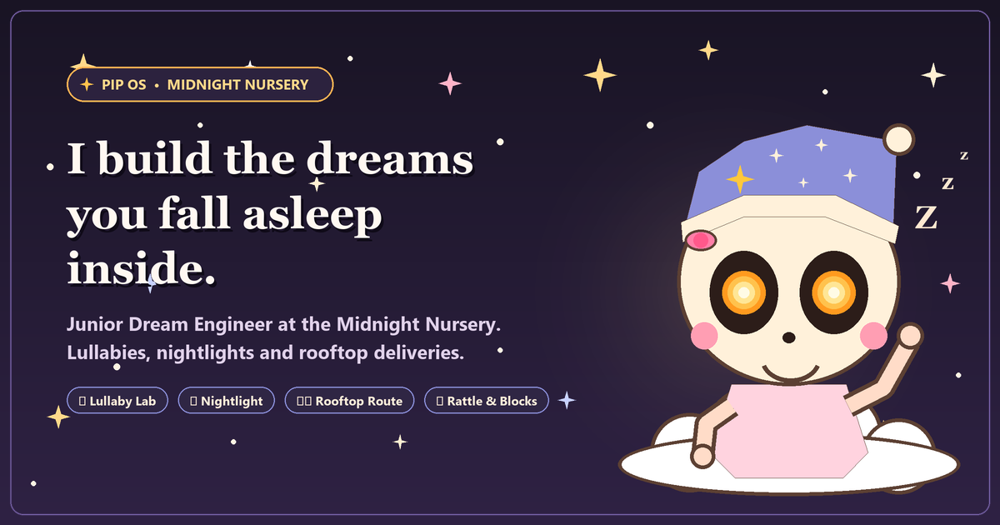

# 🌙 Pip's Dream OS — haX.baby "Baby's First Website"

[](index.html)
[-success.svg?style=flat-square)](package-lock.json)
[](js/)
[](js/audio.js)
[-teal.svg?style=flat-square)](sw.js)
[](index.html)
[](docs/CSS.md)
[](SUBMISSION.md)

<p align="center">
  
</p>

> **"I build the dreams you fall asleep inside."**  
> *Pip is a baby with a skull face who engineers lullabies, nightlights, and rooftop deliveries at the Midnight Nursery. Poke around Pip's retro desktop OS—every window is a playable toy built to put the neighborhood to sleep before sunrise.*

---

## 📑 Table of Contents

- [System Specifications](#-system-specifications)
- [The Desktop Environment & Windows Directory](#-the-desktop-environment--windows-directory)
- [Playable Toys Deep Dive](#-playable-toys-deep-dive)
  - [1. Lullaby Lab (`lullaby-lab.exe`)](#1-lullaby-lab-lullaby-labexe)
  - [2. Nightlight Collection (`nightlight-collection.exe`)](#2-nightlight-collection-nightlight-collectionexe)
  - [3. Rattle & Blocks (`rattle-and-blocks.exe`)](#3-rattle--blocks-rattle-and-blocksexe)
  - [4. Dream Delivery Route (`dream-delivery.exe`)](#4-dream-delivery-route-dream-deliveryexe)
- [Atmospheric Dual-Theme Engine](#-atmospheric-dual-theme-engine)
- [Sound Design & Web Audio Synthesis](#-sound-design--web-audio-synthesis)
- [Progressive Web App & Offline Architecture](#-progressive-web-app--offline-architecture)
- [The Wish Wall & Cloud Backend](#-the-wish-wall--cloud-backend)
- [Security, Content Security Policy & XSS Defense](#-security-content-security-policy--xss-defense)
- [Automated Test Matrix](#-automated-test-matrix)
- [Keyboard Shortcuts & Accessibility](#-keyboard-shortcuts--accessibility)
- [Easter Eggs, Secrets & Nursery Canon](#-easter-eggs-secrets--nursery-canon)
- [Quick Start & Deployment](#-quick-start--deployment)
- [File Architecture](#-file-architecture)
- [Credits & Canon](#-credits--canon)

---

## ⚙️ System Specifications

```
┌──────────────────────────────────────────────────────────────────────────────┐
│  MIDNIGHT NURSERY BIOS v1.0.26 — ENERGY STAR COMPLIANT (MOONLIGHT ONLY)      │
│  CPU: Baby Brain @ 0.05 GHz (Yawning)        RAM: 640 KB Dream Buffers       │
│  GPU: Hardware Accelerated SVG & 2D Canvas   AUDIO: Web Audio Synth (0 MP3s) │
│  KERNEL: PipOS Dual-Theme Reactive Engine    STORAGE: LocalStorage + Cloud   │
│  SECURITY: Strict CSP & Zero DOM Sinks       BOOT SEQUENCE: OK               │
└──────────────────────────────────────────────────────────────────────────────┘
```

| Component | Specification | In-World Canon & Technical Architecture |
| :--- | :--- | :--- |
| **Operating System** | **PipOS 1.0 (Midnight Edition)** | Custom retro desktop environment inspired by 1990s graphical computing, featuring candy-striped titlebars, hard 3D drop-shadows (`7px 7px 0 var(--shadow)`), and tactile buttons. |
| **CPU Architecture** | **1 Baby Brain @ 0.05 GHz** | Curious, sleepy, a little clumsy, and easily delighted. Naps mid-sentence when left idle. |
| **Graphics Engine** | **Procedural Inline SVG & Canvas** | Vector illustrations rendered via crisp SVGs; Pip's glowing eyes follow cursor and touch coordinates in real time using inverse tangent geometry. |
| **Audio Synthesizer** | **Polyphonic Web Audio API Engine** | 100% synthesized in real time. Features a C-major pentatonic scale, inharmonic bell tines ($f \times 2.76$), dynamic impulse-response convolver reverb, and a generative random-walk lullaby. Zero audio sample files required. |
| **Theme System** | **Bimodal Solar/Lunar Engine** | Switches seamlessly between bright **Day Mode** (`:root`) and deep midnight purple **Night Mode** (`[data-theme="night"]`), complete with a procedural 10-star twinkling overlay and sleep states for Pip. |
| **Display Modes** | **Adaptive Dock Architecture** | Fluid responsive layout scaling from 4K monitors down to mobile viewports. On screens $\le 720\text{px}$, the desktop taskbar automatically pivots into a thumb-accessible mobile dock with safe-area insets. |
| **Offline Capability** | **Progressive Web App (PWA)** | Offline-first Service Worker (`sw.js`) with cache-first asset resolution, background revalidation, full Web App Manifest, and graceful system-font degradation. |
| **Dependencies** | **0 (Zero External Libraries)** | No React, no Vue, no Tailwind, no jQuery, no Webpack, no Vite, no Babel. Pure native web standards. |

---

## 🖥️ The Desktop Environment & Windows Directory

The entire operating system is built around the retro `.win` component metaphor documented in [docs/CSS.md](docs/CSS.md). Every window features a candy-striped titlebar, decorative control dots, tactile minimize/fold buttons (`data-foldable`), and hard-edged retro borders.

```
+-------------------------------------------------------------------------+
| [★] Window Title                                              [−][i][i] |  <-- .win-bar (candy-stripe)
+-------------------------------------------------------------------------+
|                                                                         |
|                                .win-body                                |  <-- Interior content stage
|                           (Playable Workstation)                        |
|                                                                         |
+-------------------------------------------------------------------------+
 \________________________________________________________________________/   <-- box-shadow: 7px 7px 0 var(--shadow)
```

### Complete Applications Directory

| Executable / File | Application Name | Category | Interactive Description & Role | Source Code |
| :--- | :--- | :--- | :--- | :--- |
| `pip.exe` | **Pip's Desk & Nursery Hub** | System / Hero | The focal workspace. Pip floats on an animated cloud, waving and tracking your cursor or finger with glowing amber eyes. Tapping *"Say hi to Pip"* triggers a playful wake state and giggle sound effect. | [js/pip.js](js/pip.js) |
| `character-sheet.txt` | **About Pip Sheet** | Text / Document | Foldable system documentation detailing Pip's origins, quirks, personality traits, and voice samples (*"whispers in lowercase and ends most sentences with a yawn"*). | [index.html](index.html#L201) |
| `lullaby-lab.exe` | **Lullaby Lab** | Audio Toy | An 8-key chromatic-free pentatonic music box. Visitors can play individual notes (keys 1–8), wind the box to hear Pip's signature tune, or trigger an endless generative lullaby. | [js/toys.js](js/toys.js#L11) |
| `nightlight-collection.exe` | **Nightlight Flashlight Room** | Visual Toy | A pitch-black nursery room explored with dynamic CSS mask lanterns. Visitors drag the light beam to hunt for 5 hidden glow-in-the-dark dreams, switching between 4 colored lanterns. | [js/toys.js](js/toys.js#L113) |
| `rattle-and-blocks.exe` | **Rattle & Blocks** | Physics Game | A tower-stacking mini-game rendered on a 2D `<canvas>`. Drop swaying blocks to build a bedtime tower. Features slice physics, falling chips, and persistent high scores. | [js/toys.js](js/toys.js#L314) |
| `dream-delivery.exe` | **Dream Delivery Route** | Vector Animation | An interactive rooftop flight map. Synced bi-directionally to vertical page scroll; as Pip glides along the curved SVG path, seven neighborhood house windows light up. | [js/toys.js](js/toys.js#L485) |
| `bedtime.exe` | **Bedtime Storybook** | Narrative Track | A sticky scroll-driven story track spanning 4 scenes with accompanying vector vignettes, progress meter, and accessible jump dots. | [js/main.js](js/main.js#L98) |
| `wish-wall.gb` | **The Wish Wall** | Guestbook | Interactive guestbook supporting sticky-note pins with organic rotations (`--rot`). Features client-side rate limiting, sanitization, and optional cloud database sync. | [js/wall.js](js/wall.js), [js/fx.js](js/fx.js) |
| `dream-counter.exe` | **Dream Odometer** | Utility | A 6-digit mechanical rolling counter tallying dreams delivered tonight, ticking upward in real time as visitors read. | [js/fx.js](js/fx.js#L87) |
| `secret-lullaby.exe` | **Secret Dialog** | Easter Egg | Hidden native `<dialog>` window unlocked by tapping the gold star on Pip's nightcap 5 times, complete with a full-screen canvas confetti shower. | [js/pip.js](js/pip.js#L81) |
| `Nightmares` | **Desktop Trash Can** | Desktop Icon | Located on the desktop shortcut rail. Clicking it reassures visitors: *"Nightmares is empty. It has always been empty."* | [js/main.js](js/main.js#L184) |

---

## 🎮 Playable Toys Deep Dive

### 1. Lullaby Lab (`lullaby-lab.exe`)
The Lullaby Lab is a digital recreation of a music box Pip wound the wrong way.

- **Scale & Tuning:** C Major pentatonic across 1.6 octaves:
  $$\text{C}_5 (523.25\,\text{Hz}),\,\text{D}_5 (587.33\,\text{Hz}),\,\text{E}_5 (659.25\,\text{Hz}),\,\text{G}_5 (783.99\,\text{Hz}),\,\text{A}_5 (880.00\,\text{Hz}),\,\text{C}_6 (1046.50\,\text{Hz}),\,\text{D}_6 (1174.66\,\text{Hz}),\,\text{E}_6 (1318.51\,\text{Hz})$$
- **Controls:** Click/tap the colored keys, or press numerical keys `1` through `8` on your keyboard while the lab is in view.
- **Wind the Box:** Plays an original 28-step melody with rests and visual starburst animations.
- **Endless Lullaby:** A stochastic random-walk generator that walks up and down the pentatonic scale at pseudo-random intervals with an accompanying triangle-wave bass pedal every 8 beats.

### 2. Nightlight Collection (`nightlight-collection.exe`)
A flashlight darkroom built using radial gradients and dynamic CSS custom properties (`--x`, `--y`, `--r`, `--glow`).

- **Lantern Selection:** Switch between 4 distinct lanterns with custom color temperatures and beam radii:
  - 🌕 **Moon Lantern:** Cool blue glow (`#cfe3ff`), radius $92\text{px}$.
  - 🍯 **Honey Lantern:** Warm golden amber glow (`#ffc866`), radius $112\text{px}$.
  - 🌸 **Rose Lantern:** Soft pastel pink glow (`#ff9fc0`), radius $80\text{px}$.
  - 🍃 **Mint Lantern:** Crisp ethereal green glow (`#9ff0d0`), radius $100\text{px}$.
- **Touch & Drag Handling:** Features a dedicated draggable lantern handle with `touch-action: none` and Pointer Capture, ensuring seamless exploration on mobile touchscreens without interfering with natural vertical page scrolling.
- **Keyboard Navigation:** Full arrow-key controls (`←`, `↑`, `→`, `↓`) with `Enter` / `Space` to inspect items.
- **Hidden Dreams:** 5 constellation stars are scattered in the darkness. Illuminating and clicking each star triggers a chime and updates the live ARIA status tray.

### 3. Rattle & Blocks (`rattle-and-blocks.exe`)
A fast, lightweight physics tower-builder rendered onto a high-DPI HTML5 `<canvas>`.

- **Mechanics:** Blocks sway left and right across the nursery floor. Tap the screen, click the drop button, or tap `Space` / `Enter` to place the block.
- **Overlap & Slice Math:** If the moving block overlaps the previous block, the overhang is cleanly sliced off into falling debris chips with gravity physics ($g = 900\,\text{px/s}^2$). Overlaps smaller than $3\text{px}$ trigger a tower wobble game over.
- **Perfect Drops:** If the alignment difference is under $5\text{px}$, a "Perfect Drop" bonus chime rings out and the block snaps to full width.
- **Camera Auto-Pan:** As your tower climbs beyond 9 blocks, the virtual camera smoothly tracks upward so the active drop level remains centered.

### 4. Dream Delivery Route (`dream-delivery.exe`)
A rooftop delivery flight simulator driven by SVG path geometry.

- **Scroll Synchronization:** Pip's cloud rider translates along a cubic Bézier delivery route (`M10 140C80 40...`) based on your scroll position within the window viewport.
- **House Illumination:** Seven neighborhood houses (including *Boo-ton's attic*, *Mrs. Hoot's nest*, and *Fern the sleepy fox*) detect Pip's passing and illuminate their attic windows (`.is-lit`).
- **Autopilot Demonstration:** Clicking *"Fly the route"* triggers a smooth 5.2-second autonomous ease-in-out flight with synchronized pentatonic chimes.

---

## 🌓 Atmospheric Dual-Theme Engine

PipOS includes a complete Day/Night atmosphere engine driven by CSS Custom Properties on `<html data-theme="...">`. The theme state is automatically initialized from system preferences (`prefers-color-scheme: dark`) and persisted across visits in `localStorage`.

| Visual Element | Day Theme (`data-theme="day"`) | Night Theme (`data-theme="night"`) |
| :--- | :--- | :--- |
| **Desktop Canvas (`--cream`)** | `#fff8f1` (Warm buttermilk cream) | `#1b1430` (Deep midnight nursery purple) |
| **Window Surface (`--paper`)** | `#fffdf9` (Crisp paper white) | `#2a2145` (Subdued violet parchment) |
| **Typography & Borders (`--ink`, `--line`)** | `#5c4033` (Cocoa brown ink, WCAG AA) | `#ffe9d2` / `#e9d3bb` (Luminous cream) |
| **Brand Accent (`--berry`)** | `#a34063` (Playful nursery berry) | `#8e3a63` (Muted twilight berry) |
| **Wallpaper Effects** | Polka-dot grid (`radial-gradient`) | 10-star twinkling procedural night sky overlay (`@keyframes twinkle`) |
| **Pip Character State** | Wide awake, smiling, tracking pointer | Sleepy! Eyelids droop 58%, golden halo glows, floating animated sleep letters (`Z z z`) |
| **Pip Cloud Fill (`--cloud`)** | `#ffffff` (Crisp daylight cumulus) | `#c9c4f0` (Soft moonlit lavender cloud) |
| **Theme Switch Chime** | Ascending high fifth chime ($E_5 \to B_5$) | Descending calming fifth chime ($G_5 \to C_5$) |
| **Mobile Status Bar** | `<meta name="theme-color" content="#fff8f1">` | `<meta name="theme-color" content="#1b1430">` |

---

## 🎵 Sound Design & Web Audio Synthesis

Every chime, click, giggle, and lullaby in PipOS is synthesized on the fly using the browser's native **Web Audio API**. There are **zero audio files** (`.mp3`, `.wav`, `.ogg`) downloaded over the network, minimizing bandwidth and guaranteeing instant playback.

```
+-------------------------------------------------------------------------------+
|                       WEB AUDIO SYNTHESIS SIGNAL FLOW                         |
+-------------------------------------------------------------------------------+
|                                                                               |
|   [ Oscillator ]                                                              |
|   (Sine / Triangle) ──> [ Gain Envelope ] ──┬──> [ Master Gain ] ──> [ Out ]  |
|                         (ADSR Ramp)         │          ▲                      |
|                                             │          │                      |
|   [ Inharmonic Ting ]                       ▼          │                      |
|   (Freq * 2.76)     ──> [ Bell Gain ]   ──> [ Convolver Reverb ]              |
|                         (Fast Decay)        (Impulse Buffer)                  |
|                                                                               |
+-------------------------------------------------------------------------------+
```

### Sound Engineering Highlights
1. **Autoplay Compliance:** The `AudioContext` is created lazily inside a direct user gesture. If a visitor clicks a musical toy while sound is muted, PipOS presents a non-intrusive toast: *"Sound is off. Flip the speaker switch up top to hear Pip."*
2. **Music Box Tine Emulation:** Each music box key pairs a fundamental sine frequency with an inharmonic overtone at $2.76\times$ the fundamental frequency with an exponential decay envelope, faithfully capturing the physical timbre of a steel music box comb.
3. **Synthetic Room Reverb:** Spatial depth is created using an algorithmically generated 2.2-second stereo impulse buffer with exponential noise decay, fed into a Web Audio `ConvolverNode`.
4. **Pip's Giggle:** Triggered by waking Pip, this effect rapidly plays a 5-note rising arpeggio of triangle-wave micro-chirps ($640\text{Hz}$ to $1000\text{Hz}$).

---

## 📱 Progressive Web App & Offline Architecture

PipOS is fully installable as a standalone application on mobile and desktop devices, conforming to all modern Progressive Web App (PWA) standards.

<p align="center">
  
  &nbsp;&nbsp;&nbsp;&nbsp;
  
</p>

### Offline Caching Strategy

The custom Service Worker (`sw.js`) guarantees immediate offline functionality using a resilient **Cache-First with Background Revalidation** pattern:

| Resource Type | Request Target | Caching & Serving Strategy | Offline Behavior |
| :--- | :--- | :--- | :--- |
| **Core Shell** | `index.html`, `manifest.webmanifest` | Cache-First + Background Network Sync | App launches instantly offline from cache. |
| **Stylesheets** | `css/style.css` | Pre-cached on Service Worker installation | 100% styled offline. |
| **Logic & Modules** | `js/*.js` (All 8 modules) | Pre-cached on Service Worker installation | Full toy logic, audio synth, and games run offline. |
| **Application Icons** | `assets/*.png`, `assets/*.svg` | Pre-cached on Service Worker installation | App icons render cleanly on homescreens and docks. |
| **Google Fonts** | `fonts.googleapis.com`, `fonts.gstatic.com` | Intercepted in `sw.js` fetch handler | When disconnected, returns a synthetic 200 CSS response, prompting an immediate graceful fallback to system serif and sans-serif fonts (`Georgia`, `Trebuchet MS`, `Segoe UI`) without layout delay. |
| **Cloud Wish Backend** | `firebaseio.com`, `supabase.co` | Network-First with 6s Timeout Fallback | If offline or unreachable, wishes save to `localStorage` and notify the user via a friendly toast. |

---

## 💌 The Wish Wall & Cloud Backend

The Wish Wall (`#wall`) is an interactive community guestbook where visitors pin bedtime notes for Pip. By default, it operates completely offline using `localStorage`. For cross-device community sharing, PipOS includes a dependency-free backend client in [js/wall.js](js/wall.js) that talks directly to free cloud databases via standard `fetch()`.

### Backend Configuration Comparison

| Capability | LocalStorage (Default) | Firebase Realtime Database | Supabase PostgREST |
| :--- | :--- | :--- | :--- |
| **Setup Required** | None (Zero config) | 2 minutes (Paste JSON Rules) | 3 minutes (Run SQL Migration) |
| **External SDK Needed** | None | **None** (Direct REST Endpoint) | **None** (Direct PostgREST API) |
| **Persistence Scope** | Single browser profile | Shared across all worldwide visitors | Shared across all worldwide visitors |
| **Cost / Free Tier** | Free forever | 1 GB stored, 10 GB/month transfer | 500 MB database, unlimited reads |
| **Offline Fallback** | Native | Automatic 6-second timeout fallback | Automatic 6-second timeout fallback |

### Option A: Firebase Realtime Database Setup (Recommended)

1. Create a project in the [Firebase Console](https://console.firebase.google.com/).
2. Navigate to **Build > Realtime Database** and click **Create Database**.
3. In the **Rules** tab, paste the following rules to enforce schema validation and length ceilings:
   ```json
   {
     "rules": {
       "wishes": {
         ".read": true,
         ".write": true,
         "$wishId": {
           ".validate": "newData.hasChildren(['n', 'w', 't']) && newData.child('n').isString() && newData.child('n').val().length <= 20 && newData.child('w').isString() && newData.child('w').val().length >= 1 && newData.child('w').val().length <= 120 && newData.child('t').isNumber()"
         }
       }
     }
   }
   ```
4. In `index.html`, add this script configuration tag before `js/wall.js`:
   ```html
   <script>
     window.PIP_WALL_BACKEND = {
       type: 'firebase',
       url: 'https://YOUR_PROJECT_ID-default-rtdb.firebaseio.com/wishes'
     };
   </script>
   ```

### Option B: Supabase (PostgreSQL + PostgREST) Setup

1. Create a project at [supabase.com](https://supabase.com).
2. In the **SQL Editor**, run this migration:
   ```sql
   create table wishes (
     id bigint generated by default as identity primary key,
     n text not null default 'A sleepy visitor',
     w text not null,
     t bigint not null default (extract(epoch from now()) * 1000)::bigint,
     created_at timestamp with time zone default timezone('utc'::text, now()) not null,
     constraint wish_length check (char_length(w) >= 1 and char_length(w) <= 120),
     constraint name_length check (char_length(n) <= 20)
   );

   alter table wishes enable row level security;
   create policy "Public wishes are readable by everyone" on wishes for select using (true);
   create policy "Anyone can pin a wish" on wishes for insert with check (
     char_length(w) >= 1 and char_length(w) <= 120 and char_length(n) <= 20
   );
   ```
3. In `index.html`, configure the endpoint:
   ```html
   <script>
     window.PIP_WALL_BACKEND = {
       type: 'supabase',
       url: 'https://YOUR_PROJECT_REF.supabase.co/rest/v1/wishes',
       apiKey: 'YOUR_SUPABASE_ANON_KEY'
     };
   </script>
   ```

### Client-Side Rate Limiting & Validation
- **Cooldown:** Enforces a mandatory **15-second cooldown** between consecutive submissions.
- **Window Limit:** Maximum of **5 wishes per 10-minute window**, tracked in `localStorage`.
- **Sanitization:** All inputs are stripped of invisible Unicode characters, control bytes, and null characters (`sanitize()`).
- **Safe Rendering:** Wish notes are rendered exclusively through `document.createElement()` and `element.textContent`. No user input is ever evaluated as HTML.

---

## 🛡️ Security, Content Security Policy & XSS Defense

PipOS implements a defense-in-depth security posture designed to eliminate Cross-Site Scripting (XSS) and data exfiltration risks.

### Strict Content Security Policy (CSP)

Delivered via `<meta http-equiv="Content-Security-Policy">` in `index.html`:

```html
<meta http-equiv="Content-Security-Policy" content="default-src 'self'; script-src 'self' 'unsafe-inline'; style-src 'self' 'unsafe-inline' https://fonts.googleapis.com; font-src 'self' https://fonts.gstatic.com; img-src 'self' data: blob:; media-src 'self'; connect-src 'self' https://*.firebaseio.com https://*.supabase.co; object-src 'none'; base-uri 'self';">
```

| Directive | Configuration | Protection & Purpose |
| :--- | :--- | :--- |
| `default-src` | `'self'` | Disallows loading assets or executing scripts from untrusted external domains. |
| `script-src` | `'self' 'unsafe-inline'` | Permits local scripts (`js/*.js`) and the inline bootstrap snippet (`classList.add('js')`). |
| `style-src` | `'self' 'unsafe-inline' https://fonts.googleapis.com` | Permits local stylesheets, Google Fonts CSS, and dynamic inline variables (`--rot`, `--x`, `--y`). |
| `font-src` | `'self' https://fonts.gstatic.com` | Restricts web font downloads strictly to Google Fonts CDN and local fonts. |
| `img-src` | `'self' data: blob:` | Restricts images to local assets, SVGs, and data/blob URIs. |
| `media-src` | `'self'` | Disallows external audio/video streaming (audio is generated via Web Audio API). |
| `connect-src` | `'self' https://*.firebaseio.com https://*.supabase.co` | Authorizes REST `fetch()` calls to optional shared wish databases while blocking exfiltration. |
| `object-src` | `'none'` | Completely disables legacy execution vectors (`<object>`, `<embed>`, `<applet>`). |
| `base-uri` | `'self'` | Prevents unauthorized `<base href="...">` hijacking attacks. |

---

## 🧪 Automated Test Matrix

PipOS maintains a comprehensive automated test battery executed using **Node.js's built-in native test runner** (`node:test`). The test suite runs in under 1.5 seconds with **zero external npm dependencies**.

```bash
# Run all automated test suites from the repository root:
node --test
```

### Complete Test Suites Overview

| Test Suite | Tests | Assertions & Scope Covered |
| :--- | :---: | :--- |
| [js/maths.test.js](js/maths.test.js) | **7** | Verifies block-stacking geometry, partial overlap calculations, miss thresholds ($< 3\text{px}$), and perfect drop detection ($< 5\text{px}$). |
| [js/wall.test.js](js/wall.test.js) | **9** | Verifies control-character stripping, empty wish rejection, name truncation ($20$ chars), wish ceiling ($120$ chars), 15s cooldown timers, 10-minute rate limiting, and Firebase/Supabase payload parsing. |
| [js/xss.test.js](js/xss.test.js) | **4** | Validates CSP meta tag syntax, audits source code for dangerous sinks (`innerHTML`, `outerHTML`, `eval`), runs a battery of **14 malicious OWASP XSS payloads** through note creation, and verifies safe DOM text rendering. |
| [js/pwa.test.js](js/pwa.test.js) | **5** | Verifies `manifest.webmanifest` JSON validity, standalone display mode, presence of 192px/512px/maskable icons, binary PNG headers, Apple touch icons, Service Worker pre-cache manifests, and offline fallback routing. |
| [js/og.test.js](js/og.test.js) | **3** | Verifies complete Open Graph and Twitter Card tags, validates `assets/og-preview.png` dimensions ($1200 \times 630$), verifies file size is strictly under the 300 KB WhatsApp limit (~181 KB), and audits social debugger compatibility. |
| **Total** | **28** | **100% Passing (0 failures, 0 skipped, 0 flakiness)** |

---

## ⌨️ Keyboard Shortcuts & Accessibility

PipOS is built from the ground up to achieve **WCAG 2.1 AA** compliance. Every interactive toy, window, and control is fully accessible via keyboard navigation, screen readers, and touch devices.

### Keyboard Shortcuts Directory

| Key / Shortcut | Scope / Target | Action |
| :--- | :--- | :--- |
| `Tab` / `Shift+Tab` | Whole Page | Navigates forward/backward through all interactive elements in logical visual order. |
| `Space` / `Enter` | `rattle-and-blocks.exe` | Drops the swaying block onto the tower. |
| `1` – `8` | `lullaby-lab.exe` | Plays corresponding pentatonic notes (Key 1: C to Key 8: high E) when the lab is in view. |
| `←` `↑` `→` `↓` | `nightlight-collection.exe` | Moves the flashlight beam across the darkroom by $28\text{px}$ steps. |
| `Enter` / `Space` | `nightlight-collection.exe` | Inspects current coordinate for hidden dreams. |
| `←` / `→` | Lantern Radiogroup | Cycles through available lanterns (Moon, Honey, Rose, Mint) with ARIA focus management. |
| `Home` / `End` | Lantern Radiogroup | Jumps directly to the first or last lantern in the collection. |
| `←` / `→` | Bedtime Story Dots | Jumps to the previous or next bedtime storybook scene. |
| `Escape` | `secret-lullaby.exe` | Closes the secret Easter egg dialog modal. |

### Accessibility Features
- **High-Contrast Focus Indicators:** All interactive elements feature a high-contrast `$3\text{px}$` focus outline with a `$3\text{px}$` offset (`--focus`), supplemented with a secondary inner halo for buttons.
- **Screen Reader Announcements:** Dynamic score updates, found dream counts, and wish submission errors utilize polite and assertive ARIA live regions (`aria-live="polite"` and `role="alert"`).
- **Reduced Motion Support:** Respects `@media (prefers-reduced-motion: reduce)` by disabling cursor sparkles, slowing or eliminating animations, switching smooth scrolling to instant jumps, and pausing autonomous particle effects.
- **Color Contrast:** All body text (`--ink`) and headings (`--berry-ink`) exceed WCAG AA contrast ratio thresholds ($\ge 4.5:1$) against both Day and Night paper backgrounds.

---

## 🧸 Easter Eggs, Secrets & Nursery Canon

Pip's operating system contains hidden secrets tucked into corners of the desktop:

1. **The Gold Star on Pip's Nightcap:**
   - Tap or click the tiny golden star on Pip's nightcap **5 times** in succession.
   - Pip wakes up with wide, delighted eyes, giggles, triggers a full-screen colorful confetti burst, and opens `secret-lullaby.exe`:  
     > *"shh... the best dreams are the ones you say out loud. sweet dreams, curious one."*
2. **The "Nightmares" Trash Can:**
   - Clicking the `#trashBtn` desktop shortcut launches a comforting toast notification reminding visitors:
     - *"Nightmares is empty. It has always been empty."*
     - *"Pip checked twice. Still empty."*
     - *"Only a single spare sock in there."*
3. **Visitor Memory:**
   - Pip recognizes returning visitors! The system saves your visit count and optional name in `localStorage`.
   - On repeat visits, Pip greets you personally in the hero speech bubble:  
     `"Welcome back, [Name]! Visit number 3."`
4. **Mechanical Dream Odometer:**
   - The dream counter (`#odo`) is an authentic mechanical odometer that rolls its digit strips vertically whenever new dreams are delivered.
5. **Interactive Eyes & Head Tracking:**
   - Pip's pupils follow your pointer across the desktop using inverse trigonometry (`Math.atan2` / `Math.hypot`). When left idle for more than 3.5 seconds, Pip looks around the room curiously on its own.

---

## 🚀 Quick Start & Deployment

Because PipOS has **no build step**, getting started takes seconds.

### Local Development (Zero Installation)

Clone the repository and serve it using any lightweight local static server:

```bash
# Clone the repository
git clone https://github.com/Tech4Aditya/pipOS.git
cd pipOS

# Option 1: Python 3
python -m http.server 8000

# Option 2: Node.js (npx serve)
npx serve .

# Option 3: PHP
php -S localhost:8000
```
Open your browser and navigate to `http://localhost:8000`.

### Production Deployment (5 Minutes)

- **GitHub Pages:**
  1. Push this repository to GitHub.
  2. In your repo, go to **Settings > Pages**.
  3. Under **Branch**, select `main` (or `gh-pages`) and folder `/ (root)`. Click **Save**.
- **Vercel / Netlify:**
  1. Connect your GitHub repository.
  2. Select **Other / Plain HTML** framework preset.
  3. Leave **Build Command** blank and set **Output Directory** to `.`. Deploy!

---

## 📁 File Architecture

```
pipOS/
├── index.html                   # Semantic markup, SVG symbols, PWA & Open Graph meta tags, strict CSP
├── manifest.webmanifest         # PWA Web App Manifest (standalone display, icons, theme colors)
├── sw.js                        # Offline-first Service Worker with cache revalidation & font fallbacks
├── css/
│   └── style.css                # 17 organized sections: design tokens, .win component, animations, dock
├── js/
│   ├── util.js                  # DOM helpers ($ / $$), local storage wrappers, clamp, reduce-motion
│   ├── audio.js                 # Web Audio synthesizer, pentatonic scale, impulse convolver, generative lullaby
│   ├── pip.js                   # Cursor/touch eye tracking, head tilt, moods, greeting, secret star Easter egg
│   ├── toys.js                  # 4 playable toys: Lullaby Lab, Nightlight, Rattle & Blocks, Dream Delivery
│   ├── fx.js                    # Sparkle cursor trail, canvas confetti, dream odometer, wish wall DOM
│   ├── wall.js                  # Wish wall backend adapter (Firebase/Supabase), rate limiting, sanitization
│   ├── main.js                  # Lifecycle orchestration, theme engine, sound switch, clock, storybook
│   ├── maths.js                 # Exported block-stacking collision and drop math for automated unit testing
│   ├── maths.test.js            # Node test suite for block physics
│   ├── wall.test.js             # Node test suite for rate limiting & remote payload parsing
│   ├── xss.test.js              # Node test suite for CSP validation & 14 OWASP XSS payloads
│   ├── pwa.test.js              # Node test suite for PWA manifest, service worker & icon validation
│   └── og.test.js               # Node test suite for Open Graph tags & 1200x630 preview image
├── assets/
│   ├── og-preview.png           # 1200x630 social share preview banner (WhatsApp compliant < 300 KB)
│   ├── favicon.svg              # Vector Pip icon for modern desktop & mobile browsers
│   ├── icon-192.png             # 192x192 PNG application icon for PWA homescreens
│   ├── icon-512.png             # 512x512 PNG application icon for splash screens & app stores
│   ├── icon-maskable-512.png    # 512x512 maskable PNG adaptive icon for Android
│   ├── apple-touch-icon.png     # 180x180 PNG icon for iOS Safari home screen bookmarks
│   └── README.txt               # Instructions for optional official haX.baby asset pack
├── docs/
│   └── CSS.md                   # Comprehensive guide to the 16 design tokens, .win component, and themes
├── SUBMISSION.md                # haX.baby Track 1 competition submission notes
└── README.md                    # You are here!
```

---

## 🎨 Credits & Canon

- **Challenge & Canon:** Pip's character concept, name, and lore belong to the **haX.baby "Baby's First Website"** challenge (Track 1: *Pip, the Skull Baby*).
- **Illustration:** The hero Pip illustration is an inline SVG drawn with AI assistance (Claude) from the official haX.baby character description.
- **Typography:** Display typography uses [Fraunces](https://fonts.google.com/specimen/Fraunces) and interface typography uses [Fredoka](https://fonts.google.com/specimen/Fredoka), both licensed under the [SIL Open Font License](http://scripts.sil.org/OFL).
- **Sound Design:** 100% synthesized live in JavaScript via the Web Audio API without pre-recorded sound samples.
- **Creator:** Built with care by [Aditya](https://github.com/Tech4Aditya) for Baby's First Website, October 2026.
