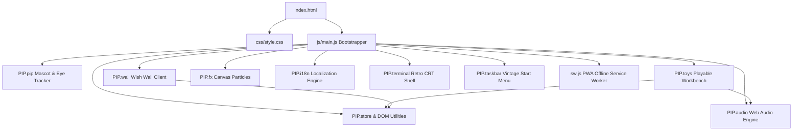

# 🏛️ Pip OS Architecture & Technical Deep Dive

Pip's Dream OS is built on a modular, zero-dependency vanilla web architecture. This document explains the system design, the `window.PIP` namespace, the mathematics behind Pip's interactive SVG mascot, and the organization of all workbench toys.

---

## 1. High-Level Architecture

Pip OS operates without bundlers, compilers, or runtime frameworks. Each module registers itself under the global `window.PIP` namespace and initializes independently through safe wrappers, ensuring that a runtime exception in one toy never compromises the rest of the operating system.



---

## 2. The `window.PIP` Module Catalog

| Module | File | Responsibility | Key APIs |
| :--- | :--- | :--- | :--- |
| **DOM Utilities** | `js/util.js` | Micro selectors and safe state storage | `PIP.$`, `PIP.$$`, `PIP.store.get()`, `PIP.store.set()`, `PIP.clamp()` |
| **Audio Synthesizer** | `js/audio.js` | Synthesizes live chimes, pops, and giggles with the Web Audio API | `PIP.audio.note()`, `PIP.audio.pop()`, `PIP.audio.isOn()`, `PIP.audio.setVolume()` |
| **Interactive Mascot** | `js/pip.js` | SVG rendering, pointer tracking, pupil kinematics, and mood states | `PIP.pip.look()`, `PIP.pip.glance()`, `PIP.pip.setMood()`, `PIP.pip.wake()` |
| **Playable Workbench** | `js/toys.js` | Houses the logic for all interactive nursery toys | `PIP.toys.init()`, `PIP.toys.HOUSE_STORIES` |
| **Wish Wall Client** | `js/wall.js` (see [Specification](WISH_WALL_SPEC.md)) | Validates, sanitizes, rate limits, and synchronizes visitor wishes offline/online | `PIP.wall.validateWish()`, `PIP.wall.checkRateLimit()`, `PIP.wall.syncPendingWishes()` |
| **Visual Effects** | `js/fx.js` | Confetti physics explosions and pointer sparkle trails | `PIP.fx.confetti()`, `PIP.fx.sparkle()` |
| **Localization** | `js/i18n.js` | Dictionary engine for real-time English and Hindi translation | `PIP.i18n.setLanguage()`, `PIP.i18n.t()`, `PIP.i18n.TRANSLATIONS` |
| **Sticker Book** | `js/stickers.js` | Manages achievement unlocks and sticker badges | `PIP.stickers.unlock()`, `PIP.stickers.isUnlocked()`, `PIP.stickers.reset()` |
| **Retro CRT Shell** | `js/terminal.js` | Virtual shell with command parsing, history, and tab completion | `PIP.terminal.executeCommand()`, `PIP.terminal.autocomplete()` |
| **Taskbar & Launcher** | `js/taskbar.js` | Vintage Start Menu, app shortcuts, and window controls | `PIP.taskbar.open()`, `PIP.taskbar.close()`, `PIP.taskbar.toggle()` |

---

## 3. How Pip's SVG & Eye Tracking Work

Pip's mascot (`#pipSvg`) is a fully vector SVG illustration comprising a floating cloud, round skull head, starry nightcap, and animated facial features.

### Anatomy of Pip's Eyes & Sockets
In `index.html`:
```html
<ellipse class="p-socket" cx="160" cy="214" rx="38" ry="46"/>
<ellipse class="p-socket" cx="260" cy="214" rx="38" ry="46"/>

<g clip-path="url(#clipL)">
  <g class="pupil" id="pupilL">
    <circle cx="160" cy="214" r="26" fill="url(#gGlow)"/>
  </g>
</g>
<g clip-path="url(#clipR)">
  <g class="pupil" id="pupilR">
    <circle cx="260" cy="214" r="26" fill="url(#gGlow)"/>
  </g>
</g>
```
The `<clipPath>` definitions bound pupil movement to the interior of each orbital socket, preventing pupils from spilling outside the skull.

### The Tracking Mathematics (`look(x, y)` in `js/pip.js`)
When a pointer moves across the screen (or when `glance()` points Pip toward a section):
1. **Delta Vector**: Computes the difference between pointer coordinates `(x, y)` and each eye socket's screen center `(r.left + r.width/2, r.top + r.height/2)`:
   $$\Delta x = x - x_{\text{socket}}, \quad \Delta y = y - y_{\text{socket}}$$
2. **Euclidean Distance**:
   $$d = \sqrt{\Delta x^2 + \Delta y^2}$$
3. **Non-Linear Dampening**: A coefficient $k$ scales sensitivity as the cursor gets closer:
   $$k = \min(d / 170, 1)$$
4. **Pupil Clamping**:
   $$\text{translate}X = \frac{\Delta x}{d} \times k \times \text{MAX\_X} \quad (\text{where } \text{MAX\_X} = 14\text{px})$$
   $$\text{translate}Y = \frac{\Delta y}{d} \times k \times \text{MAX\_Y} \quad (\text{where } \text{MAX\_Y} = 18\text{px})$$
5. **Head Tilt**: The entire `#pipHead` group rotates slightly toward the pointer:
   $$\text{angle} = v_x \times 3.5^{\circ}$$

---

## 4. Where Each Toy Lives

All playable toys live within `js/toys.js` and have dedicated markup anchors in `index.html`:

| Toy Name | Program ID | Anchor | DOM Element | Implementation Function |
| :--- | :--- | :--- | :--- | :--- |
| **Lullaby Lab** | `pip-lab.exe` | `#lab` | `#labKeys`, `#labMelodySelect` | `initLab()` |
| **Nightlights** | `nightlight-collection.exe` | `#lights` | `#darkroom`, `.dr-room` | `initLights()` |
| **Rattle & Blocks** | `pip-blocks.exe` | `#blocks` | `#blockCanvas`, `#blockScore` | `initBlocks()` |
| **Dream Delivery** | `pip-route.exe` | `#route` | `#routeCanvas`, `#houseStory` | `initRoute()` |
| **Bedtime Story** | `pip-story.exe` | `#story` | `#storyPages`, `.scenes` | `initStory()` / `initStorybook()` |
| **Growth Chart** | `pip-growth-chart.exe` | `#growth` | `#growthChart`, `.growth-fill` | `initGrowthChart()` |
| **Sticker Book** | `stickers.exe` | `#stickers` | `#stickersGrid`, `#stickersReset` | `PIP.stickers.init()` |
| **CRT Terminal** | `terminal.exe` | `#terminal` | `#termScreen`, `#termInput` | `PIP.terminal.init()` |

---

## 5. Offline PWA Architecture

Pip OS is an installable Progressive Web App powered by `sw.js`:
- **Cache-First Strategy**: All essential local assets (`index.html`, `css/style.css`, all `js/*.js` modules, icons, and manifest) are pre-cached upon service worker installation.
- **Graceful Network Degradation**: Offline requests are served instantly from cache. External resources (such as Google Fonts) degrade safely to system fonts (`Comic Sans MS`, `system-ui`) without blocking rendering.
