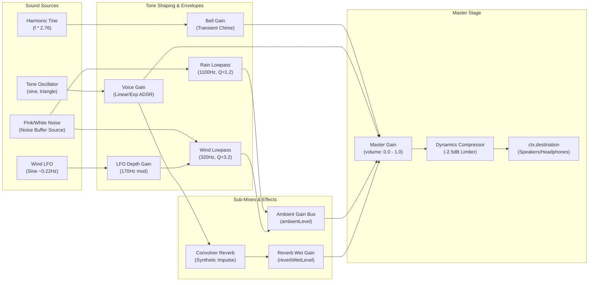

# 🎵 Web Audio Synthesizer & Procedural Ambience Engine

The Pip OS audio subsystem is implemented in [`js/audio.js`](file:///c:/Users/Rushabh%20Mahajan/Documents/GitHub/pipOS/js/audio.js). In alignment with the zero-dependency philosophy of the project, all sounds, musical chimes, clicks, ambient backgrounds (rain, wind, crickets), and reverberation effects are synthesized live in real time using the W3C Web Audio API without external audio files, samples, or MP3/WAV assets.

---

## 1. System Architecture & Audio Node Graph

The audio graph utilizes a master bus architecture featuring dynamic range compression, dry/wet convolution reverberation, and sub-mix gain stages for voice notes and procedural ambience.



### ASCII Routing Schema

```text
[Tone Voice: Sine] ----------> [ADSR Gain] ---------------> [Master Gain] ---> [Compressor] ---> [destination]
  \ (Optional Overtone)           \                            ^
   ---> [Harmonic: f*2.76] ----> [Bell Gain] ------------------|
                                    \                          |
                                     ---> [Convolver] -> [Wet] |
[Ambient: Noise Buffer] -> [Biquad Filter] -> [Ambient Bus] ---|
                                    ^
[LFO Oscillator] --------> [LFO Gain]
```

---

## 2. Audio Context Lifecycle & Autoplay Handling

Modern web browsers enforce autoplay policies that suspend `AudioContext` until an explicit user interaction occurs. Pip OS handles this gracefully with lazy instantiation and gesture unlocking:

1. **Lazy Initialization (`ensure()`)**:
   - `AudioContext` is not constructed on script load.
   - It is initialized inside `ensure()` upon the first user interaction (such as toggling the speaker button or clicking a playable toy).
   - If `ctx.state === 'suspended'`, `ctx.resume()` is invoked.

2. **Persistent Sound State**:
   - Stored in `PIP.store` under the key `'sound'` (`'on'`, `'off'`, or `''` if unset).
   - When set to `'off'`, active oscillators and ambient loops are stopped, and `ctx.suspend()` is called to conserve CPU cycles and battery.
   - When set to `'on'`, `ctx.resume()` restores audio output.

3. **Page Visibility Management**:
   - A listener on `document.visibilitychange` automatically suspends the audio context when the browser tab is hidden (`document.hidden === true`).
   - Resumes playback seamlessly when the user refocuses the tab, provided the sound switch remains enabled.

---

## 3. Melody & Chime Synthesis

### Frequency Tables & Scales
Pip OS employs the C Major Pentatonic scale across the upper register to guarantee that any sequence of randomly generated notes or user interactions sounds harmonious without dissonance.

```javascript
// C major pentatonic across ~1.6 octaves (Music Box Tines)
var SCALE = [523.25, 587.33, 659.25, 783.99, 880.0, 1046.5, 1174.66, 1318.51];
// C5      D5      E5      G5      A5     C6      D6       E6

// Bass drone roots
var BASS = [261.63, 196.0, 220.0, 174.61];
// C4      G3     A3     F3
```

### ADSR Gain Envelopes
Notes played through `PIP.audio.note(freq, opts)` support custom ADSR (Attack, Decay, Sustain, Release) envelope curves:

- **Attack ($a$)**: Linear ramp from $0.0001$ to peak `gain`.
- **Decay ($d$)**: Linear decay from peak gain to the sustain level `sGain = gain * sRatio`.
- **Sustain ($s$)**: Level maintained over `hold = max(0, dur - a - d - r)`.
- **Release ($r$)**: Exponential decay towards $0.0001$ ending the note.

```javascript
// Example: Triggering a warm synth pad with custom ADSR
PIP.audio.note(523.25, {
  dur: 2.4,
  gain: 0.15,
  type: 'sine',
  adsr: { a: 0.6, d: 0.4, s: 0.7, r: 1.0 }
});
```

### Acoustic Glockenspiel / Music-Box Harmonic
When `opts.bell !== false` (default for music box tines), a secondary oscillator is spawned at $f \times 2.76$ with a sharp transient attack ($4\text{ ms}$) and rapid exponential decay ($dur \times 0.28$). This physical acoustic modeling simulates the metallic inharmonic strike of a physical tine or chime.

---

## 4. Procedural Ambient Sound Generators

All atmospheric audio effects are computed algorithmically using custom audio buffers and synthesis graphs:

### 1. Pink Noise Generator (`makeNoiseBuffer`)
Pink noise produces equal energy per octave, sounding softer and more natural than harsh white noise. `makeNoiseBuffer` generates pink noise using the 3-pole Paul Kellet filter approximation algorithm:

$$\begin{aligned}
b_0 &= 0.99886 \cdot b_0 + \text{white} \cdot 0.0555179 \\
b_1 &= 0.99332 \cdot b_1 + \text{white} \cdot 0.0750759 \\
b_2 &= 0.96900 \cdot b_2 + \text{white} \cdot 0.1538520 \\
\text{sample} &= (b_0 + b_1 + b_2 + \text{white} \cdot 0.5362) \cdot 0.18
\end{aligned}$$

### 2. Gentle Rain (`startRain()` / `stopRain()`)
- Sources a looped 3-second pink noise buffer.
- Feeds into a second-order `BiquadFilterNode` (`type: 'lowpass'`, frequency $1100\text{ Hz}$, $Q = 1.2$).
- Connects through the ambient gain stage to create a soft, continuous downpour effect.

### 3. Procedural Wind Gusts (`startWind()` / `stopWind()`)
- Loops a 4-second pink noise buffer through a resonant lowpass filter ($f_0 = 320\text{ Hz}$, $Q = 3.2$).
- A Low-Frequency Oscillator (LFO sine wave oscillating at $\sim 0.22\text{ Hz}$) connects through `windLfoGain` directly to the `filter.frequency` AudioParam.
- Sweeping the filter cutoff between $\sim 150\text{ Hz}$ and $\sim 490\text{ Hz}$ mimics the natural surging and receding sound of outdoor wind gusts.

### 4. Nighttime Crickets (`startCrickets()` / `stopCrickets()`)
- Uses a recurring jittered timer (`1800ms + Math.random() * 1600ms`).
- Triggers 2 to 3 micro-chirps in quick succession ($55\text{ ms}$ spacing).
- Each chirp is a high-frequency sine tone ($4500\text{ Hz} \pm 200\text{ Hz}$) with rapid linear attack ($8\text{ ms}$) and fast exponential dropoff ($45\text{ ms}$).

---

## 5. Synthetic Convolver Reverb

Rather than bundling heavy impulse response WAV files, `js/audio.js` builds a stereo impulse response directly in memory via `makeImpulse(ctx, seconds, decay)`:

```javascript
function makeImpulse(c, seconds, decay) {
  var rate = (c && c.sampleRate) || 44100;
  var len = Math.max(1, Math.floor(rate * (seconds || 2.2)));
  decay = typeof decay === 'number' ? decay : 3;
  var buf = c.createBuffer(2, len, rate);
  
  for (var ch = 0; ch < 2; ch++) {
    var d = buf.getChannelData(ch);
    for (var i = 0; i < len; i++) {
      // Noise attenuated by an exponential power decay curve
      d[i] = (Math.random() * 2 - 1) * Math.pow(1 - i / len, decay);
    }
  }
  return buf;
}
```

- Generates 2.2 seconds of stereo-decorrelated decay noise.
- Provides lush spatial depth to music box tines and synthesizer notes.
- Controllable wet mix ratio via `setReverbWet(val)` (default: `0.28`).

---

## 6. Bedtime Sleep Timer with Exponential Fade-Out

`PIP.audio.startSleepTimer(minutes, onFinish)` allows users to fall asleep to procedural rain or endless lullabies:

- Tracks remaining duration via high-resolution timestamps.
- **Fade-Out Curve**: During the final 60 seconds, master gain decays exponentially towards zero:
  $$\text{targetGain} = \text{initialVolume} \times \left( \frac{\text{remainingSeconds}}{60} \right)^2$$
- On completion, automatically calls `stopAll()`, applies the nocturnal theme (`setNightTheme()`), and displays a notification toast (*"Pip fell fast asleep. Sweet dreams!"*).

---

## 7. Public API Reference

The entire audio engine is exposed on the global `PIP.audio` namespace:

### Core Playback & State
| Method | Description |
| :--- | :--- |
| `PIP.audio.isOn()` | Returns `true` if audio is currently enabled (`state === 'on'`). |
| `PIP.audio.toggle()` | Toggles audio on or off and plays confirmation chimes. |
| `PIP.audio.request()` | Requests audio activation. If unconfigured, turns sound on; if disabled by user, shows instructional toast. |
| `PIP.audio.setVolume(val)` | Sets master volume clamped to $[0.0, 1.0]$ and updates `PIP.store`. |
| `PIP.audio.getVolume()` | Returns current master volume level. |
| `PIP.audio.stopAll()` | Immediately halts all oscillators, timers, and ambient loops, and sets sound state to `'off'`. |
| `PIP.audio.onChange(callback)` | Registers listener function invoked when sound state changes. |

### Notes & Melodies
| Method | Description |
| :--- | :--- |
| `PIP.audio.note(freq, opts)` | Plays a synthesized note at `freq` Hz. Options: `dur`, `gain`, `when`, `type`, `bell`, `adsr`. |
| `PIP.audio.pad(freq, opts)` | Plays a soft ambient chord pad with slow attack ($0.6\text{s}$) and long release ($1.0\text{s}$). |
| `PIP.audio.pop()` | Plays a gentle UI pop click on random pentatonic notes for button/link clicks. |
| `PIP.audio.giggle()` | Plays Pip's signature giggle: 5 rising rapid triangle blips. |
| `PIP.audio.startEndless(onNote)` | Starts continuous generative lullaby random-walk on the pentatonic scale. |
| `PIP.audio.stopEndless()` | Stops generative lullaby playback. |
| `PIP.audio.isEndless()` | Returns whether the endless lullaby is currently running. |

### Procedural Ambience
| Method | Description |
| :--- | :--- |
| `PIP.audio.startRain()` | Starts continuous procedural rain pink-noise filter loop. |
| `PIP.audio.stopRain()` | Stops rain sound generator. |
| `PIP.audio.isRainActive()` | Returns `true` if rain audio is active. |
| `PIP.audio.startWind(opts)` | Starts lowpass-filtered swept LFO wind generator. `opts.lfoFreq` configures gust speed. |
| `PIP.audio.stopWind()` | Stops wind generator and disconnects LFO oscillator. |
| `PIP.audio.isWindActive()` | Returns `true` if wind audio is active. |
| `PIP.audio.startCrickets()` | Starts periodic procedural cricket chirp loop. |
| `PIP.audio.stopCrickets()` | Stops cricket chirps. |
| `PIP.audio.isCricketsActive()` | Returns `true` if cricket sound is active. |
| `PIP.audio.stopAmbient()` | Stops rain, wind, and cricket generators simultaneously. |
| `PIP.audio.setAmbientLevel(val)` | Sets ambient sub-mix volume level $[0.0, 1.0]$. |
| `PIP.audio.getAmbientLevel()` | Returns ambient sub-mix volume level. |

### Master Bus & Effects
| Method | Description |
| :--- | :--- |
| `PIP.audio.setReverbWet(val)` | Configures wet mix ratio for synthetic convolution reverb $[0.0, 1.0]$. |
| `PIP.audio.getReverbWet()` | Returns current convolution reverb wet level. |
| `PIP.audio.configureLimiter(opts)` | Modifies dynamics compressor threshold, knee, ratio, attack, or release. |
| `PIP.audio.startSleepTimer(mins, cb)` | Starts bedtime sleep timer with automatic 60-second fadeout and theme transition. |
| `PIP.audio.stopSleepTimer()` | Cancels active sleep timer. |
| `PIP.audio.getSleepTimerRemaining()` | Returns remaining seconds until sleep timer completion. |
| `PIP.audio.isSleepTimerActive()` | Returns `true` if sleep timer is actively counting down. |
