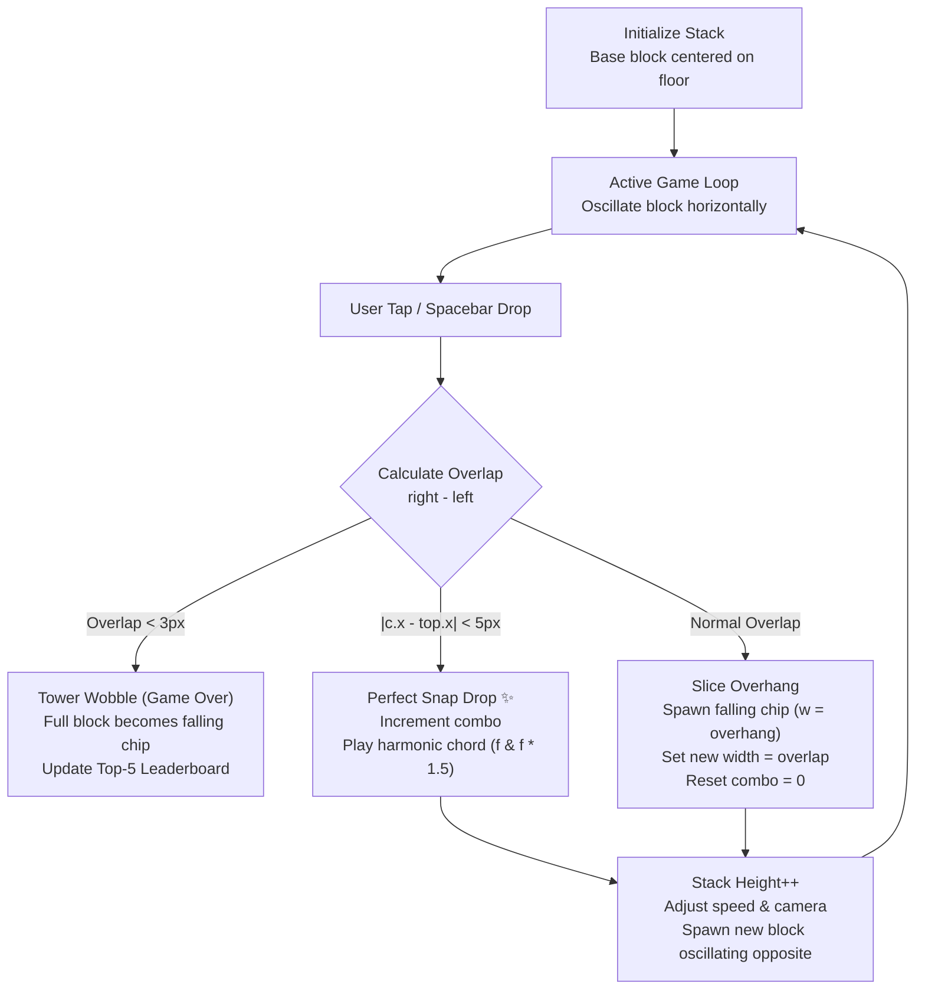

# 🧱 Rattle & Blocks Physics Stacker & Leaderboard Engine

The Rattle & Blocks physics stacking game (`stacker.exe` / `pip-blocks`) is implemented in [`js/toys.js`](file:///c:/Users/Rushabh%20Mahajan/Documents/GitHub/pipOS/js/toys.js). It provides a retro 1D oscillating block tower builder featuring precise overhang geometry slicing, dynamic freefall chip particle physics, camera vertical tracking, difficulty tiers, pentatonic pitch-scaled audio harmonics, and a persistent top-5 leaderboard.

---

## 1. System Overview & Architecture

The block stacker runs on an HTML5 canvas ($W = 300\text{ px}$, $H = 420\text{ px}$, block height $BH = 28\text{ px}$) rendered at high-DPI resolution ($\text{DPR} \le 3.0$).



---

## 2. Oscillation Kinematics & Speed Scaling

Blocks oscillate horizontally along the X-axis across the playfield width ($W = 300\text{ px}$):

### Motion Equation
$$x(t + \Delta t) = x(t) + \text{dir} \times v_{\text{speed}} \times \Delta t$$
Where:
- $\text{dir} \in \{1, -1\}$ (toggled upon colliding with playfield boundaries $x \le 0$ or $x + w \ge W$).
- Successive blocks alternate initial entry directions: $\text{dir}_{\text{initial}} = (\text{stack.length} \pmod 2 === 1) \; ? \; 1 : -1$.

### Dynamic Speed Acceleration Curve
As the tower climbs higher, oscillation speed increases linearly up to a mode-specific velocity cap:
$$v_{\text{speed}} = \min(v_{\text{base}} + \text{score} \times v_{\text{step}}, \, v_{\text{max}})$$

### Smooth Camera Vertical Tracking
To keep the active stacking level visible on screen as the tower ascends past the canvas ceiling, a virtual camera offset (`st.cam`) smoothly interpolates upward:
$$\text{targetCam} = \max(0, (\text{stack.length} - 9)) \times BH$$
$$\text{cam}(t + \Delta t) = \text{cam}(t) + (\text{targetCam} - \text{cam}(t)) \times \min(1, \, 6 \times \Delta t)$$

---

## 3. Overhang Slicing Geometry

When the player triggers a drop, the game compares the current oscillating block (`cur`) against the previous resting top block (`top`):

```text
       [======= Current Oscillating Block (cur) =======]
                 |                             |
                 v (left)                      v (right)
         +---------------+---------------------+---------------+
         | Left Overhang |    Valid Overlap    | Right Overhang|
         +---------------+---------------------+---------------+
                         |                     |
                 [======= Top Resting Block (top) =======]
```

### Mathematical Formulas

1. **Overlap Boundaries**:
   $$\text{left} = \max(\text{cur.x}, \, \text{top.x})$$
   $$\text{right} = \min(\text{cur.x} + \text{cur.w}, \, \text{top.x} + \text{top.w})$$
   $$\text{overlap} = \text{right} - \text{left} = \min(\text{cur.x} + \text{cur.w}, \, \text{top.x} + \text{top.w}) - \max(\text{cur.x}, \, \text{top.x})$$

2. **Perfect Snap Threshold**:
   If $|\text{cur.x} - \text{top.x}| < 5\text{ px}$:
   - The block snaps perfectly to the top block: $\text{cur.x} = \text{top.x}$, $\text{cur.w} = \text{top.w}$.
   - No overhang chip is generated.
   - Triggers the **Perfect! ✨** combo streak.

3. **Overhang Chip Generation**:
   If not a perfect drop and $\text{overlap} \ge 3\text{ px}$:
   - **Left Overhang** ($\text{cur.x} < \text{top.x}$):
     $$\text{chip.w} = \text{top.x} - \text{cur.x}, \quad \text{chip.x} = \text{cur.x}$$
   - **Right Overhang** ($\text{cur.x} + \text{cur.w} > \text{top.x} + \text{top.w}$):
     $$\text{chip.w} = (\text{cur.x} + \text{cur.w}) - (\text{top.x} + \text{top.w}), \quad \text{chip.x} = \text{top.x} + \text{top.w}$$
   - Chips with width $\text{chip.w} \ge 2\text{ px}$ are transferred to the falling chips array `st.chips`.
   - The new stacked block width narrows to:
     $$\text{new.w} = \max(3, \, \text{overlap}), \quad \text{new.x} = \text{left}$$

4. **Wobble / Miss (Game Over)**:
   If $\text{overlap} < 3\text{ px}$ or $\text{isNaN}(\text{overlap})$:
   - The entire block becomes a falling chip.
   - The stack terminates with game over status (`st.over = true`).
   - The score is submitted to the Top-5 Leaderboard.

---

## 4. Chip Physics Simulation & Gravity Inversion

Cut overhang chips detach and tumble under gravitational acceleration:

### Physics Equations
$$\begin{aligned}
v_y(t + \Delta t) &= v_y(t) + g \times \Delta t \\
y(t + \Delta t) &= y(t) + v_y(t) \times \Delta t
\end{aligned}$$
Where default gravitational acceleration is $g = +900\text{ px/s}^2$.

### Gravity Inversion Protocol
The physics update supports directional gravity inversion multipliers:
$$g_{\text{effective}} = g \times \text{gravityDir}$$
- **Normal Gravity** ($\text{gravityDir} = 1$): Chips accelerate downward towards the floor.
- **Inverted Gravity** ($\text{gravityDir} = -1$): Chips accelerate upward into the night sky.
- **Boundary Culling**: Chips are purged from memory once they clear the screen threshold ($y > H + \text{cam} + 60\text{ px}$ in downward mode).

---

## 5. Audio Harmonics & Combo Scaling

Pip OS rewards consecutive accurate drops with ascending musical harmonies synthesized live via `PIP.audio.note()`:

### Combo Pitch Multiplier
Consecutive perfect drops ($|\Delta x| < 5\text{ px}$) increment `st.combo`:
$$\text{pitchMult} = 1.1^{\min(\text{combo}, 8)}$$
Or via the helper:
$$\text{pitchMult} = 1.08^{\min(\text{combo} - 1, 8)}$$

### Note Frequency Formula
$$f_{\text{drop}} = \text{SCALE}[\text{score} \pmod {\text{scaleLen}}] \times (\text{score} \pmod {10} < 5 \; ? \; 1.0 : 1.5) \times \text{pitchMult}$$

### Acoustic Voicing
- **Normal Drop**: Plays fundamental chime $f_{\text{drop}}$ (duration $0.8\text{s}$, gain $0.15$).
- **Perfect Snap**: Plays fundamental chime $f_{\text{drop}}$ (duration $1.4\text{s}$, gain $0.22$) plus a harmonizing **perfect fifth** overtone ($f \times 1.5$, duration $1.2\text{s}$, gain $0.10$, delay $+70\text{ ms}$).
- **Game Over (Wobble)**: Plays a low triangle dissonance at $196\text{ Hz}$ ($G3$, duration $0.6\text{s}$, gain $0.20$).

---

## 6. Difficulty Modes & Palettes

Players can switch difficulty modes on the fly. Each mode configures different initial widths, base velocities, and difficulty ramps:

| Difficulty Mode | Initial Width (`start`) | Base Speed (`base`) | Acceleration (`step`) | Speed Cap (`max`) | Gameplay Description |
| :--- | :---: | :---: | :---: | :---: | :--- |
| **Easy** | $200\text{ px}$ | $90\text{ px/s}$ | $+5\text{ px/s}$ / block | $240\text{ px/s}$ | Wide initial block, slow and gentle pacing |
| **Normal** | $160\text{ px}$ | $120\text{ px/s}$ | $+8\text{ px/s}$ / block | $340\text{ px/s}$ | Standard challenge, balanced speed curve |
| **Hard** | $110\text{ px}$ | $160\text{ px/s}$ | $+12\text{ px/s}$ / block | $430\text{ px/s}$ | Narrow initial block, fast and aggressive ramp |

### Visual Theming & Palettes
- **Candy Theme** (Default): Pastel color sequence (`#ff9fb4`, `#ffd27a`, `#9fd8c4`, `#9ab8f0`, `#d3a8f2`, `#ffb08a`), chocolate outlines (`#5c4033`), soft cream highlights.
- **Midnight Theme**: Neon cyber-palette (`#7c6cff`, `#3ec9ff`, `#ff5fc8`, `#4dffb0`, `#ffd35c`, `#ff7a5c`), deep violet canvas (`#1b1430`), dark plum outlines (`#140e24`).

---

## 7. Leaderboard Storage Schema & Serialization

Top scores are saved locally in `PIP.store` under the key `'blockTopScores'`.

### Storage JSON Schema
```json
[28, 22, 19, 14, 9]
```

### Ranking & Insertion Algorithm (`saveTopScore(score)`)
1. Reads and deserializes `'blockTopScores'` (defaults to `[]`).
2. Appends new score if `score > 0`.
3. Sorts array in descending numerical order: `scores.sort((a, b) => b - a)`.
4. Truncates array to keep only the **top 5** scores: `scores.slice(0, 5)`.
5. Re-serializes to LocalStorage via `store.set('blockTopScores', JSON.stringify(scores))`.
6. Triggers real-time DOM update in `#blockLeaderboardList`.

### Portable Backup / Import Format (`exportScores()` / `importScores()`)
```json
{
  "game": "rattle-and-blocks",
  "version": "1.0",
  "best": 28,
  "mode": "normal",
  "topScores": [28, 22, 19, 14, 9],
  "exportedAt": "2026-11-19T16:30:00.000Z"
}
```

---

## 8. Public JavaScript API Reference

Exposed under `window.PIP.toys`:

```javascript
PIP.toys = {
  updateLeaderboardList: Function,   // (list, newScore, mode) -> top5Array
  getComboPitchMultiplier: Function, // (combo: number) -> number
  getBestMarkerY: Function,          // (best: number, cam: number) -> worldY
  exportScores: Function,            // () -> JSON string
  importScores: Function             // (jsonOrObject) -> boolean
};
```
