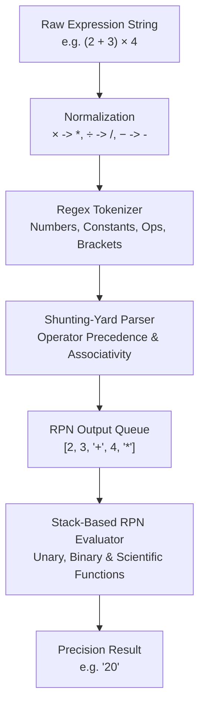

# 🧮 Starlight Scientific Calculator & Parser Engine

The Starlight Scientific & Nursery Calculator (`starlight-calc.exe`) is implemented in [`js/calc.js`](file:///c:/Users/Rushabh%20Mahajan/Documents/GitHub/pipOS/js/calc.js). It provides an LCD-styled scientific calculator featuring standard arithmetic, trigonometry, logarithms, power exponents, bracketed expressions, memory registers, an interactive sheep-counter bedtime Easter egg, and pentatonic audio chime feedback.

---

## 1. Mathematical Parsing & Shunting-Yard Algorithm

The core evaluation logic is encapsulated in `evaluateExpression(exprStr, isRadian)`. Rather than using insecure `eval()` or `Function()` constructors, Pip OS implements a deterministic two-phase parser based on **Edsger Dijkstra's Shunting-Yard Algorithm**, compiling infix expressions into Reverse Polish Notation (RPN) before stack-based evaluation.



### Phase 1: Normalization & Tokenization
1. Unicode mathematical symbols are normalized into standard operators:
   - `×` $\rightarrow$ `*`
   - `÷` $\rightarrow$ `/`
   - `−` $\rightarrow$ `-`
2. A comprehensive regular expression tokenizes the input into distinct tokens:
   ```javascript
   var tokenRegex = /\s*([0-9]*\.?[0-9]+([eE][-+]?[0-9]+)?|[a-zA-Z]+|[+\-*/%^!()πe]|.)\s*/g;
   ```
3. Tokens are classified into numeric literals, constants (`π`, `e`), functions (`sin`, `cos`, `tan`, `log`, `ln`, `sqrt`, `cbrt`, `abs`), parentheses, operators (`+`, `-`, `*`, `/`, `%`, `^`), or unary negations (`u-`).

### Phase 2: Shunting-Yard Infix to RPN
- Operands and constants are pushed directly onto the output queue.
- Functions are pushed onto the operator stack.
- Left parentheses `(` are pushed onto the operator stack.
- On encountering a right parenthesis `)`, operators are popped to the output queue until a matching `(` is encountered. If a function precedes the parenthesis, it is immediately moved to the output queue.
- Operators are resolved against the operator stack according to explicit precedence and associativity.

### Phase 3: Stack-Based RPN Evaluation
A calculation stack sequentially processes the RPN stream:
- Numbers are pushed onto the stack.
- Unary operators (such as unary minus `u-` or factorial `!`) pop one operand, compute the result, and push it back.
- Binary operators pop two operands ($b$ then $a$), compute $a \text{ op } b$, and push the result.
- Trigonometric and logarithmic functions are evaluated respecting the active angle mode (`DEG` or `RAD`).
- Division by zero returns an explicit `"Error (÷ 0)"` error state without throwing exceptions.

---

## 2. Operator Precedence & Associativity Table

The shunting-yard algorithm adheres to strict algebraic hierarchy rules:

| Operator | Type | Description | Precedence | Associativity | Example |
| :---: | :---: | :--- | :---: | :---: | :--- |
| `u-` | Unary Prefix | Unary Negation | **4** | Right (`R`) | `-5^2 = -25` |
| `!` | Postfix | Factorial ($n!$) | **—** | N/A (Immediate) | `5! = 120` |
| `^` | Binary | Exponentiation ($a^b$) | **3** | Right (`R`) | `2^3^2 = 2^(3^2) = 512` |
| `*`, `/`, `%` | Binary | Multiplication, Division, Modulo | **2** | Left (`L`) | `10 / 2 * 3 = (10 / 2) * 3 = 15` |
| `+`, `-` | Binary | Addition, Subtraction | **1** | Left (`L`) | `8 - 3 + 2 = (8 - 3) + 2 = 7` |

> [!NOTE]
> Right-associativity of the exponentiation operator (`^`) ensures that multi-level powers evaluate standard mathematical tower exponents from right to left ($2^{3^2} = 2^9 = 512$, not $8^2 = 64$).

---

## 3. Floating-Point & Input Sanitization

To ensure resilient input handling on limited virtual LCD displays:

1. **Multi-Term Decimal Guarding**:
   - The decimal input handler (`inputDecimal()`) inspects the active display state.
   - Prevents duplicate decimal points within a single operand number.
   - If an operand begins with `.`, a leading `0` is automatically prepended (`0.`).
2. **Display Length Capping**:
   - Inputs are capped at 24 characters to prevent LCD buffer overflow and styling deformation.
3. **Precision Truncation**:
   - To eliminate standard IEEE 754 floating point inaccuracies (e.g. $0.1 + 0.2 = 0.30000000000000004$), all final outputs are formatted via:
   ```javascript
   String(parseFloat(ans.toPrecision(12)))
   ```
4. **Safety & Zero Division**:
   - Explicit zero-check in division (`b === 0`) returns `"Error (÷ 0)"`.
   - Undefined logarithmic domains ($x \le 0$) and negative square roots return `"Error"`.

---

## 4. Angle Mode Switching (DEG vs. RAD)

The calculator supports both **Degrees** and **Radians** for all trigonometric functions (`sin`, `cos`, `tan`):

- **Toggle**: Controlled via `#calcAngleMode` button or `PIP.calc.toggleAngleMode()`.
- **State**: Tracked in `state.isRadian` (default is `false` / Degrees).
- **Mathematical Conversion**:
  - In Radian Mode: Evaluates direct JavaScript math functions ($f(x) = \text{Math.sin}(x)$).
  - In Degree Mode: Converts angle $x$ from degrees to radians before calling trigonometric functions:
    $$\theta_{\text{rad}} = \theta_{\text{deg}} \times \frac{\pi}{180}$$

```javascript
switch (item.value) {
  case 'sin': fRes = isRadian ? Math.sin(val) : Math.sin(val * Math.PI / 180); break;
  case 'cos': fRes = isRadian ? Math.cos(val) : Math.cos(val * Math.PI / 180); break;
  case 'tan': fRes = isRadian ? Math.tan(val) : Math.tan(val * Math.PI / 180); break;
}
```

---

## 5. Memory Registers (`MC`, `MR`, `M+`, `M-`)

Memory functions are handled in `memoryOp(type)`:

- **`MC` (Memory Clear)**: Resets stored memory value to `0`, sets `hasMemory = false`, and turns off the LCD memory indicator flag `#calcMemFlag`.
- **`MR` (Memory Recall)**: Recalls the stored memory float into the active display and arms `resetNext = true`.
- **`M+` (Memory Add)**: Adds current displayed value to `state.memory`, turns on the `#calcMemFlag` indicator, and shows a confirmation toast.
- **`M-` (Memory Subtract)**: Subtracts current displayed value from `state.memory`.

```text
[LCD Screen]
+------------------------------------+
|  [M]                        RAD    |  <-- Flags: [M] active when hasMemory = true
|  (12 + 8) × 2 =                    |  <-- Expression history preview
|                                40  |  <-- Primary LCD display (up to 24 chars)
+------------------------------------+
```

---

## 6. Easter Eggs & Pentatonic Chime Feedback

### Pentatonic Musical Chimes
Every button press triggers real-time Web Audio API feedback:
- **Digits (`0`–`9`)**: Plays harmonic notes mapped from the C major pentatonic scale (`SCALE[digit % SCALE.length]`).
- **Equals (`=`)**: Plays an ascending arpeggio chord (`C5 -> A5 -> E6`).
- **Clear (`AC`/`C`)**: Plays a gentle low pop chime (`audio.pop()`).
- **Mute Toggle**: Can be muted via the `#calcMuteBtn` (`🔔 Chimes` / `🔕 Muted`).

### The Bedtime Sheep Counter
Clicking `#calcSheepBtn` (`🐑`) triggers Pip's bedtime sheep counter (`countSheep()`):
- Increments `state.sheepCount`.
- Displays `"<count> 🐑"` on the primary LCD with subtext *"Counting sheep to fall asleep..."*.
- Plays a gentle rising chime corresponding to the current count.
- When reaching **10 or more sheep**, triggers a special notification:
  > *"💤 10 sheep counted! Pip is drifting off to dreamland."*

---

## 7. Input/Output Examples & Test Cases

The table below outlines representative test expressions evaluated by the Starlight engine:

| Infix Expression | Input Keystrokes | RPN Representation | Output | Notes |
| :--- | :--- | :--- | :--- | :--- |
| `(2 + 3) × 4` | `( 2 + 3 ) × 4 =` | `2 3 + 4 *` | `20` | Parenthesis grouping over multiplication |
| `2^3^2` | `2 ^ 3 ^ 2 =` | `2 3 2 ^ ^` | `512` | Right-associative exponent tower ($2^9$) |
| `sin(90)` *(DEG)* | `90 -> sin` or `sin(90)` | `90 sin` | `1` | Degree mode conversion ($\sin(90^\circ) = 1$) |
| `sin(π / 2)` *(RAD)* | `π ÷ 2 = -> sin` | `π 2 / sin` | `1` | Radian mode direct evaluation |
| `5!` | `5 -> x!` | `5 !` | `120` | Factorial calculation |
| `10 + 5%` | `10 + 5 % =` | `10 5 % +` | `10` | Modulo arithmetic ($10 + (5 \pmod 0)$) |
| `12 ÷ 0` | `12 ÷ 0 =` | `12 0 /` | `Error (÷ 0)` | Safe zero division catch |
| `-5 + 8` | `neg 5 + 8` or `(-5)+8` | `5 u- 8 +` | `3` | Unary minus negation |
| `sqrt(144) + cbrt(27)` | `144 sqrt + 27 cbrt` | `144 sqrt 27 cbrt +` | `15` | Roots combination ($12 + 3 = 15$) |

---

## 8. Public JavaScript API Reference

Exported under `window.PIP.calc` and `module.exports`:

```javascript
PIP.calc = {
  init: Function,                   // Initializes DOM listeners and keyboard shortcuts
  getState: Function,               // Returns internal state object
  inputDigit: Function,             // (digit: number|string) -> void
  inputDecimal: Function,           // () -> void
  inputOperator: Function,          // (op: '+'|'-'|'×'|'÷'|'%'|'^') -> void
  inputBracket: Function,           // (bracket: '('|')') -> void
  calculate: Function,              // Evaluates current buffer and updates LCD
  scientificOp: Function,           // (type: 'sin'|'cos'|'tan'|'sqrt'|'cbrt'|'log'|'ln'|'fact'|'abs'|'neg'|'pi'|'e')
  memoryOp: Function,               // (type: 'MC'|'MR'|'M+'|'M-')
  clearAll: Function,               // Resets state and display to '0'
  countSheep: Function,             // Triggers bedtime sheep counting Easter egg
  toggleAngleMode: Function,        // Toggles between DEG and RAD
  toggleChimes: Function,           // Toggles audio chime feedback
  factorial: Function,              // (n: number) -> number
  evaluateExpression: Function      // (exprStr: string, isRadian: boolean) -> string
};
```
