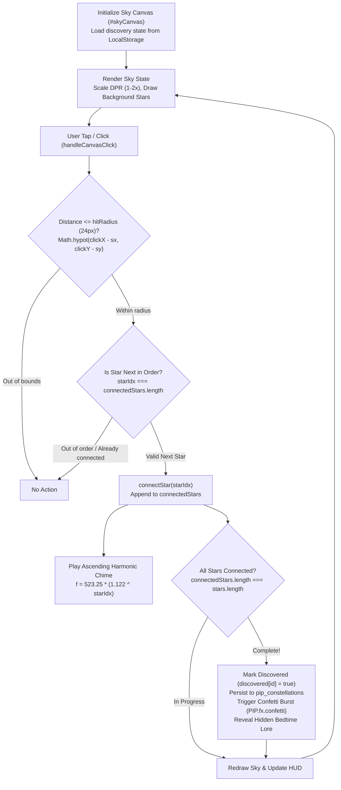

# 🌌 Constellation Dream Cartographer — Celestial Sky Engine

The Constellation Dream Cartographer (`pip-sky.exe`) is implemented in [`js/constellations.js`](file:///c:/Users/Rushabh%20Mahajan/Documents/GitHub/pipOS/js/constellations.js). It provides an interactive astronomical telescope mini-game where players discover celestial bedtime lore by sequentially connecting normalized star nodes across the night sky canvas.

---

## 1. System Architecture & Component Design

The cartographer connects vector celestial coordinates to an adaptive HTML5 canvas, evaluating pointer proximity, guiding sequential node linking, triggering harmonic audio-visual celebrations, and persisting mapped discoveries.



---

## 2. Coordinate Space Normalization

To ensure constellations render uniformly across desktop monitors, tablets, and mobile screens without distortion:

### Unit Square Mapping $[0, 1]$
Every star coordinate is stored as a dimensionless unit ratio $(x, y) \in [0.0, 1.0]$:
- $x = 0.0$ represents the extreme left edge, and $x = 1.0$ represents the extreme right edge.
- $y = 0.0$ represents the top celestial horizon, and $y = 1.0$ represents the bottom horizon.

### Responsive Viewport Scaling
During canvas drawing and hit-testing, unit coordinates are dynamically multiplied by current CSS display dimensions:
$$s_x = x \times w_{\text{css}}, \quad s_y = y \times h_{\text{css}}$$
Where $w_{\text{css}}$ and $h_{\text{css}}$ are extracted dynamically from `canvas.getBoundingClientRect()`.

### High-DPI (Retina) Pixel Ratio
To avoid fuzzy vector lines on high-resolution displays:
$$\text{DPR} = \min(\text{window.devicePixelRatio} \lor 1, \, 2.0)$$
- Canvas buffer width is allocated as $\text{Math.round}(w_{\text{css}} \times \text{DPR})$.
- Canvas context is scaled via `ctx.setTransform(dpr, 0, 0, dpr, 0, 0)`.
- Window resize events are observed with passive listeners (`window.addEventListener('resize', resizeCanvas, { passive: true })`).

---

## 3. Path Tracing, Hit-Testing & Sequential Snapping

Connecting stars requires accurate hit detection paired with strict sequential ordering:

```text
       Pointer Tap (clickX, clickY)
                 o
                /  \
               /    \  dist = Math.hypot(clickX - sx, clickY - sy)
              /      \
             v        v
        +------------------+
        |  Star Hit Radius |  hitRadius = 24px (generous touch target)
        |     ★ (sx, sy)   |
        +------------------+
```

### 1. Pointer Proximity Formula
On pointer interaction (`handleCanvasClick`), click coordinates relative to the canvas are evaluated against every star node in the active constellation:
$$\text{dist} = \sqrt{(X_{\text{click}} - s_x)^2 + (Y_{\text{click}} - s_y)^2} = \text{Math.hypot}(X_{\text{click}} - s_x, \, Y_{\text{click}} - s_y)$$

### 2. Generous Hit-Target Snapping
If $\text{dist} \le 24\text{ px}$ (`hitRadius`), a star selection is detected. This generous tolerance prevents frustration on capacitive mobile touchscreens.

### 3. Order Verification & Rollback Prevention
- Stars must be connected in strictly ascending order:
  $$\text{Valid Connection} \iff \text{starIdx} === \text{connectedStars.length}$$
- **Duplicate Prevention**: If `connectedStars.indexOf(starIdx) !== -1`, the action is ignored.
- **Out-of-Order Clicks**: Clicking star $3$ before star $2$ is ignored without penalty, keeping the constellation path clean.
- **Reset Mechanism**: `#skyResetBtn` invokes `resetCurrent()`, resetting `connectedStars = []` to allow fresh attempts.

---

## 4. Visual States & Dynamic Guidance

Each star node is rendered with clear visual hierarchy indicating its role in the tracing sequence:

| Node State | Visual Appearance | Node Radius | Glow Shadow | Guidance Cue |
| :--- | :--- | :---: | :---: | :--- |
| **Pending / Locked** | Translucent white (`rgba(255, 255, 255, 0.45)`) | $5\text{ px}$ | None | Monospace sequence number badge ($j + 1$) |
| **Next Target (`isNext`)** | Pure bright white (`#ffffff`) | $9\text{ px}$ | Golden glow ($12\text{ px}$ blur) | Highlighted target pulsing with starlight aura |
| **Connected / Linked** | Radiant gold (`#f3b562`) | $7\text{ px}$ | Warm glow ($8\text{ px}$ blur) | Golden node linked by stroke line (`lineWidth: 2.5`) |

---

## 5. Celebration Effects & Audio Harmonics

### 1. Ascending Pentatonic Micro-Chimes
Linking each consecutive star triggers `PIP.audio.note()` at an exponentially rising frequency:
$$f(\text{starIdx}) = 523.25\text{ Hz} \times 1.122^{\text{starIdx}}$$
- Node 1 ($C5$): $523.25\text{ Hz}$
- Node 2 ($D5$): $587.08\text{ Hz}$
- Node 3 ($E5$): $658.71\text{ Hz}$
- Node 4 ($F\#5$): $739.07\text{ Hz}$
- Node 5 ($G\#5$): $829.24\text{ Hz}$

### 2. Completion Celebration
When the final star in a constellation is linked (`connectedStars.length === current.stars.length`):
1. **Discovery Flag**: `discovered[current.id] = true` is persisted to storage.
2. **Confetti Cannon**: Triggers `PIP.fx.confetti(60)` launching iridescent celebratory paper into the viewport.
3. **Lore Decryption**: The `#skyLore` panel unhides the poetic bedtime mythological story associated with the constellation.
4. **Toast Notification**: Displays `"Constellation Discovered: {name}!"`.
5. **HUD Status**: The title appends `"⭐ [Mapped]"`.

---

## 6. Constellation Definition Schema & Catalog

Constellations are declared as static configuration objects in `CONSTELLATIONS`:

```javascript
{
  id: 'nightcap',                               // Unique slug identifier
  name: "Pip's Sleepy Nightcap",                // Human-readable title
  lore: 'The celestial cap worn by Pip...',     // Mythological narrative text
  stars: [                                      // Array of normalized star points
    { x: 0.25, y: 0.75 },
    { x: 0.50, y: 0.20 },
    { x: 0.75, y: 0.75 },
    { x: 0.25, y: 0.75 },
    { x: 0.55, y: 0.12 }
  ]
}
```

### The Bedtime Sky Catalog

1. **`nightcap` — Pip's Sleepy Nightcap**  
   *Lore*: The celestial cap worn by Pip on nights when the Moon reads bedtime stories to the sleeping stars.  
   *Nodes*: 5 stars outlining a nightcap cone and drooping tassel pompom.
2. **`swan` — The Starlight Swan**  
   *Lore*: Glides across the cosmic river of milk, dropping soft feathers of gentle dreams upon the nursery.  
   *Nodes*: 5 stars forming an open-winged cross constellation (Cygnus archetype).
3. **`crown` — The Queen's Crown**  
   *Lore*: A radiant zigzag crown gleaming softly above the nursery roof, guarding restful sleep.  
   *Nodes*: 5 stars forming a rhythmic zigzag crown (Cassiopeia archetype).

---

## 7. Discovery Journal Persistence

Discovery progress is serialized to `PIP.store` to maintain state across browser reloads:

- **Storage Key**: `'pip_constellations'`
- **Schema**:
  ```json
  {
    "nightcap": true,
    "swan": true,
    "crown": false
  }
  ```
- **State Hydration**: Safely parsed during initialization; unmapped constellations default to `false`.

---

## 8. Contributor Guide: Adding New Constellations

Contributors can add new constellations to `CONSTELLATIONS` in [`js/constellations.js`](file:///c:/Users/Rushabh%20Mahajan/Documents/GitHub/pipOS/js/constellations.js):

### Step-by-Step Instructions
1. Choose a unique lowercase `id` (e.g. `'bear'`, `'dipper'`, `'harp'`).
2. Compose a poetic bedtime lore description.
3. Draft star positions on graph paper or a $[0, 1] \times [0, 1]$ unit square, maintaining a padding margin ($0.15 \le x, y \le 0.85$).
4. Order the stars sequentially so that connecting $1 \rightarrow 2 \rightarrow 3 \dots$ traces the intended shape intuitively.

### Constellation Template
```javascript
// Add to CONSTELLATIONS array in js/constellations.js:
{
  id: 'slumber_bear',
  name: 'The Great Slumber Bear',
  lore: 'Curled in a celestial den of purple nebulae, snoozing peacefully until the spring morning.',
  stars: [
    { x: 0.20, y: 0.40 }, // Snout
    { x: 0.40, y: 0.25 }, // Forehead
    { x: 0.70, y: 0.30 }, // Curled spine
    { x: 0.80, y: 0.60 }, // Hind paws
    { x: 0.50, y: 0.70 }, // Front paws
    { x: 0.20, y: 0.40 }  // Close loop back to snout
  ]
}
```

---

## 9. Public JavaScript API Reference

Exposed under `window.PIP.sky` and `module.exports`:

```javascript
PIP.sky = {
  CONSTELLATIONS: Array,              // Array of constellation definition objects
  getActiveConstellation: Function,   // () -> currentConstellationObject
  setConstellationIndex: Function,    // (idx: number) -> activeIndex
  connectStar: Function,              // (starIdx: number) -> boolean
  isComplete: Function,               // () -> boolean
  resetCurrent: Function,             // Resets connected stars for active constellation
  nextConstellation: Function,        // Advances carousel to next constellation
  getDiscovered: Function             // () -> Record<string, boolean>
};
```
