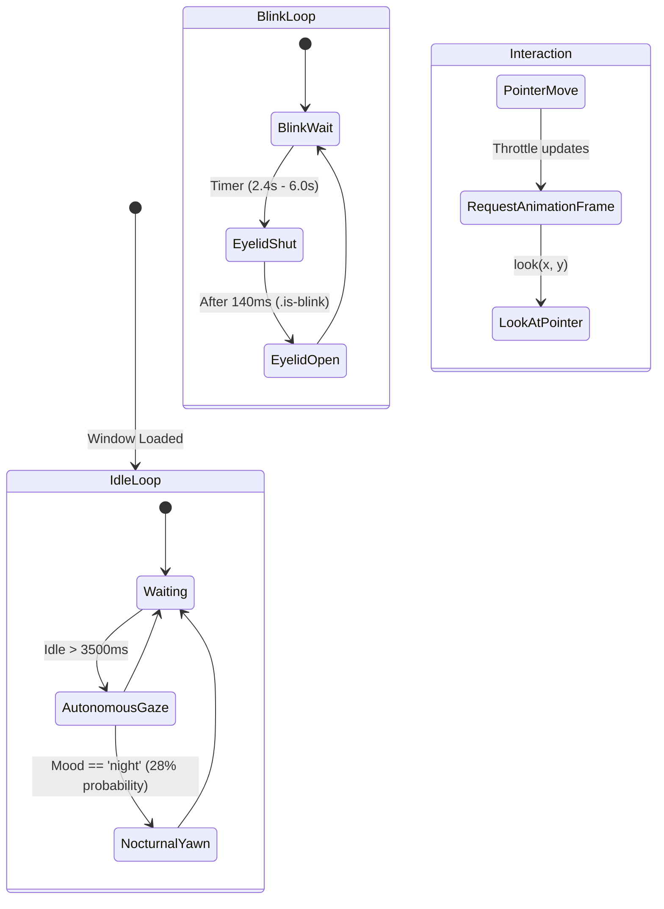
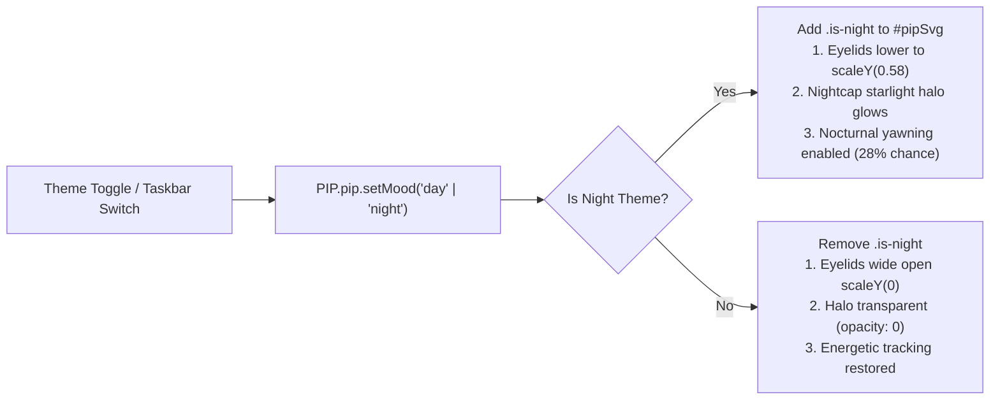

# 🧸 Pip Mascot Vector Kinematics, Eye-Tracking & Mood Engine

The interactive desktop mascot is implemented in [`js/pip.js`](file:///c:/Users/Rushabh%20Mahajan/Documents/GitHub/pipOS/js/pip.js) and rendered via inline SVG (`#pipSvg`) in [`index.html`](file:///c:/Users/Rushabh%20Mahajan/Documents/GitHub/pipOS/index.html). Pip combines real-time cursor tracking, damped polar vector clamping, procedural blinking, organic idle gaze wandering, and an emotional mood state machine that reacts to pointer haptics and diurnal system themes.

---

## 1. System Overview & Anatomy

Pip's vector body consists of layered SVG groups organized to permit independent affine transformations:

```text
#pipSvg (ViewBox: 0 0 420 380)
├── <g id="pipCloud">             // Floating cloud body & waving paws (.is-wave)
├── <g id="pipHead">              // Skull & nightcap group (rotates & translates)
│     ├── <ellipse class="p-socket" cx="160" cy="214" rx="38" ry="46" /> (Left Orbit)
│     ├── <ellipse class="p-socket" cx="260" cy="214" rx="38" ry="46" /> (Right Orbit)
│     ├── <g clip-path="url(#clipL)">
│     │     └── <g class="pupil" id="pupilL">  // Translated by look(x, y)
│     │           ├── <circle cx="160" cy="214" r="26" fill="url(#gGlow)" />
│     │           └── <ellipse class="lid" />  // Scaled by scaleY for blinking/sleep
│     └── <g clip-path="url(#clipR)">
│           └── <g class="pupil" id="pupilR">  // Translated by look(x, y)
│                 ├── <circle cx="260" cy="214" r="26" fill="url(#gGlow)" />
│                 └── <ellipse class="lid" />
├── <polygon id="pipNose" />      // Tactile touch target (triggers surprise expression)
└── <g id="egg">                  // Secret golden star Easter egg
```

---

## 2. Vector Math & Pupil Clamping Geometry

When a cursor or touch pointer moves to $(X, Y)$ across the screen, the tracking mathematics in `look(x, y)` calculate independent displacement vectors for each orbital socket:

```text
                       (X, Y) Pointer / Cursor
                           o
                          /
                         /  Delta Vector (dx, dy)
                        /   Distance d = Math.hypot(dx, dy)
                       /
                      v
             +-----------------+
             |   Socket Orbit  |  rx = 38px, ry = 46px
             |      (cx, cy)   |
             |        ●----->  |  Clamped Pupil Translation (Tx, Ty)
             +-----------------+  Max bounds: MAX_X = 14px, MAX_Y = 18px
```

### 1. Socket Origin Offsets
For each eye $i \in \{0, 1\}$, screen coordinates of the socket center are determined via `getBoundingClientRect()`:
$$\begin{aligned}
x_{\text{socket}} &= r_{\text{left}} + \frac{r_{\text{width}}}{2} \\
y_{\text{socket}} &= r_{\text{top}} + \frac{r_{\text{height}}}{2}
\end{aligned}$$

### 2. Relative Delta Vector & Euclidean Norm
$$\Delta x = X - x_{\text{socket}}, \quad \Delta y = Y - y_{\text{socket}}$$
$$d = \sqrt{\Delta x^2 + \Delta y^2} = \text{Math.hypot}(\Delta x, \, \Delta y) \quad (\text{minimum } 1.0)$$

### 3. Non-Linear Proximity Dampening
To prevent abrupt jerking when the cursor is positioned directly over Pip's face, an attenuation factor $k$ smoothly scales pupil excursion based on distance:
$$k = \min\left(\frac{d}{170}, \, 1.0\right)$$
- When $d \ge 170\text{ px}$, $k = 1.0$ (full orbital range).
- When $d < 170\text{ px}$, $k$ decreases linearly to zero, softly recentering pupils as the pointer approaches the eyes.

### 4. Elliptical Clamping Formulas
The unit direction vector is scaled by the dampening factor $k$ and hardware axis limits:
$$\begin{aligned}
T_x &= \left( \frac{\Delta x}{d} \right) \cdot k \cdot \text{MAX\_X} \quad (\text{where } \text{MAX\_X} = 14\text{ px}) \\
T_y &= \left( \frac{\Delta y}{d} \right) \cdot k \cdot \text{MAX\_Y} \quad (\text{where } \text{MAX\_Y} = 18\text{ px})
\end{aligned}$$
Displacement is applied directly via hardware-accelerated CSS transforms:
```javascript
eyes[i].el.style.transform = 'translate(' + Tx.toFixed(1) + 'px,' + Ty.toFixed(1) + 'px)';
```

### 5. SVG Socket Clipping
In addition to mathematical coordinate clamping, `<clipPath id="clipL">` and `<clipPath id="clipR">` clip all pupil circles to the exact interior boundary of each orbital socket, ensuring that extreme styling or layout shifts never allow pupils to leak outside Pip's skull.

---

## 3. Head Tilt Kinematics

In addition to eye movement, Pip's entire skull (`#pipHead`) pivots responsively toward the pointer to convey organic curiosity:

1. **Normalized Viewport Offsets**:
   $$\begin{aligned}
   v_x &= \text{clamp}\left( \left(\frac{X}{W_{\text{viewport}}} - 0.5\right) \times 2, \, -1.0, \, 1.0 \right) \\
   v_y &= \text{clamp}\left( \left(\frac{Y}{H_{\text{viewport}}} - 0.5\right) \times 2, \, -1.0, \, 1.0 \right)
   \end{aligned}$$
2. **Translation & Angular Rotation**:
   $$\text{Head Translation} = (v_x \times 5.0\text{ px}, \; v_y \times 3.0\text{ px})$$
   $$\text{Head Rotation} = v_x \times 3.5^{\circ}$$

```javascript
head.style.transform = 'translate(' + (vx * 5).toFixed(1) + 'px,' + (vy * 3).toFixed(1) + 'px) rotate(' + (vx * 3.5).toFixed(2) + 'deg)';
```

---

## 4. Animation Loops & Autonomous Behavior

Pip continues to act naturally even when the visitor is idle:



### 1. Frame-Throttled Pointer Tracking (`onPointer`)
Mouse and touch move events decouple input capture from DOM rendering using `requestAnimationFrame`, collapsing rapid $120\text{Hz}$ pointer events into single monitor-synchronized updates.

### 2. Autonomous Idle Gaze Shift (`idleLoop()`)
If the user stops moving their cursor for over $3.5\text{ seconds}$ (`performance.now() - lastPointer > 3500`), Pip drifts into an autonomous daydream state:
- Selects a pseudo-random point centered around its own position:
  $$X_{\text{idle}} = c_x + (\text{random}() - 0.5) \times 520\text{ px}$$
  $$Y_{\text{idle}} = c_y + (\text{random}() - 0.5) \times 360\text{ px}$$
- Triggers `look(X_idle, Y_idle)`.
- Reschedules randomly every $1.6\text{s} - 3.4\text{s}$ (`1600 + Math.random() * 1800`).

### 3. Procedural Blinking (`blinkLoop()`)
- Blinks recur on a Poisson-like interval between $2.4\text{s}$ and $6.0\text{s}$ (`2400 + Math.random() * 3600`).
- Toggles `.is-blink` on `#pipSvg` for exactly $140\text{ ms}$.
- Eyelids (`.lid`) instantaneously animate:
  ```css
  .pip-svg.is-blink .lid { transform: scaleY(1); }
  ```
- Respects `prefers-reduced-motion` settings.

---

## 5. Emotional Mood State Machine

Pip exhibits dynamic micro-expressions and moods triggered by interactions and diurnal cycles:

| Mood / Expression | Trigger Event | Visual Representation | Audio Feedback |
| :--- | :--- | :--- | :--- |
| **`idle`** | Default state | Open eyes (`scaleY(0)`), gentle breathing | None |
| **`surprised`** | Hovering or tapping nose (`#pipNose`) | Round open mouth (`.mouth-surprised`), wide pupil dilation | Soft pop chime (`audio.pop()`) |
| **`shy`** | Double-clicking head (`#pipHead` within 450ms) | Blushing cheeks, averted downward gaze, ducked skull | Soft pop chime (`audio.pop()`) |
| **`yawn`** | Night idle loop / Bedtime timer | Half-closed eyelids, oval yawning mouth | Triangle lullaby note ($392\text{ Hz}$ / $G4$, duration $1.4\text{s}$) |
| **`happy` / `wave`** | Clicking "Say Hi" (`#sayHi`) | Cloud paw waves (`.is-wave`), smiling mouth | Pip's signature giggle chime (`audio.giggle()`) |
| **`night` / `sleepy`** | Night theme active (`setMood('night')`) | Heavy droopy eyelids (`scaleY(0.58)`), glowing starry halo (`opacity: 1`) | Ambient procedurals |
| **`awake`** | Interacting with sleepy Pip / Star egg | Eyelids retract completely (`scaleY(0)`), pupil expands $1.3\times$ | Giggles and pentatonic arpeggio |

---

## 6. System Theme Reactivity & Sleep Mask

Pip dynamically reflects desktop theme changes:



### The Bedtime Easter Egg (`#egg`)
Tapping the secret gold star on Pip's nightcap 5 times triggers a progressive wake sequence:
1. **Taps 1–4**: Pip stirs softly in sleep (*"Pip stirred slightly..."*), playing ascending pentatonic scale chimes.
2. **Tap 5**: Pip wakes fully for $5.2\text{ seconds}$ (`wake(5200)`), launches $170$ confetti particles (`PIP.fx.confetti(170)`), giggles, plays a 5-note starlight arpeggio, unlocks the `'star'` achievement sticker, and reveals the secret bedtime diary modal (`#secret`).

---

## 7. Public JavaScript API Reference

Exposed under `window.PIP.pip` and `module.exports`:

```javascript
PIP.pip = {
  init: Function,                   // Binds event listeners, initializes loops, and greets visitor
  look: Function,                   // (x: number|HTMLElement, y?: number) -> updates eye/head kinematics
  glance: Function,                 // (target: HTMLElement|number, y?: number, duration?: number) -> void
  setMood: Function,                // (mood: 'day'|'night') -> sets diurnal mood
  wake: Function,                   // (ms?: number) -> temporarily forces wide awake state
  getMood: Function,                // () -> string ('day'|'night')
  setExpression: Function,          // (expr: 'surprised'|'shy'|'yawn', ms?: number) -> void
  surprise: Function,               // (ms?: number) -> triggers surprise micro-expression
  shy: Function,                    // (ms?: number) -> triggers bashful shy micro-expression
  yawn: Function                    // (ms?: number) -> triggers bedtime yawn and 392Hz audio note
};
```
