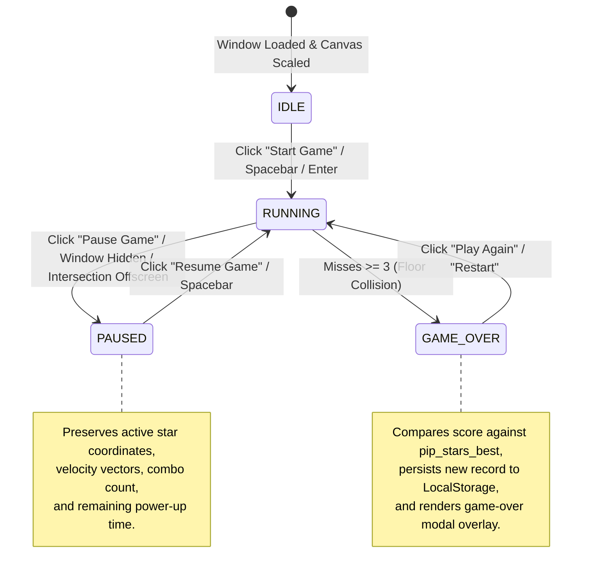

# 🌟 Catch the Falling Stars — Game Engine & Mechanics Specification

The "Catch the Falling Stars" arcade mini-game is implemented in [`js/stars.js`](file:///c:/Users/Rushabh%20Mahajan/Documents/GitHub/pipOS/js/stars.js). It provides a responsive HTML5 Canvas arcade experience where players guide Pip's sleepy cloud basket to catch descending celestial bodies, trigger special power-up archetypes, build harmonious audio chime combos, and survive across progressive difficulty levels.

---

## 1. System Architecture & State Machine

The game operates on a continuous animation frame loop driven by `requestAnimationFrame`, with state transitions governed by player controls, boundary collisions, and viewport visibility observers.



---

## 2. Canvas Render Pipeline

The rendering engine utilizes double-buffered vector canvas drawing normalized across high-density mobile and desktop screens.

### Viewport & Resolution Scaling
- **Virtual Playfield Dimensions**: Fixed coordinate space of $W = 300\text{ px}$ width by $H = 380\text{ px}$ height.
- **DPI Scaling**: Automatically adapts to high-density displays (Retina, mobile screens):
  $$\text{DPR} = \min((\text{window.devicePixelRatio} \lor 1) \times 1.15, \, 3.0)$$
  The internal canvas dimensions are set to $W \times \text{DPR}$ and $H \times \text{DPR}$, while the render context is scaled by `ctx.scale(dpr, dpr)`. This eliminates raster blur while maintaining consistent game physics across all pixel densities.

### Frame Lifecycle (`loop()`)
Every frame executed during the `RUNNING` state consists of two sequential phases:

```text
[ requestAnimationFrame ]
          │
          ▼
   [ update() ]
   ├── Evaluate wide cloud power-up expiration (wideUntil)
   ├── Lerp cloud position towards targetX: cloud.x += (targetX - cloud.x) * 0.3
   ├── Spawn stars based on dynamic interval: max(700ms, 1500ms - score * 15ms)
   ├── Step star positions: y += vy, angle += vAngle
   ├── Check collision against player cloud basket
   ├── Check floor boundary miss: y > H + r
   └── Step particle physics (velocity, life decay)
          │
          ▼
   [ render() ]
   ├── Clear viewport & draw nocturnal gradient (#100e26 to #1e1b4b)
   ├── Draw static twinkling celestial background anchors
   ├── Render falling stars (trigonometric polygon stars & diamond crystals)
   ├── Render alpha-blended spark particles
   └── Draw Pip's cloud paddle (with sleepy eyes & optional golden wide glow)
```

### Offscreen Culling via `IntersectionObserver`
To maximize battery efficiency and prevent background tab resource draining, `js/stars.js` attaches an `IntersectionObserver` to the game container. If the user scrolls the game out of view or minimizes its window, `state.visible` switches to `false` and automatically pauses active execution.

---

## 3. Star Archetype Matrix

The spawning engine dynamically generates three distinct classes of celestial bodies based on configured probability distributions:

| Archetype | Spawn Chance | Radius ($r$) | Speed ($v_y$) | Points | Visual Identity | Special Power-Up / Effect |
| :--- | :---: | :---: | :---: | :---: | :--- | :--- |
| **Normal Star** | $\sim 92\%$ | $9 - 13\text{ px}$ | $1.2 - 2.6\text{ px/f}^*$ | $10 + \text{combo} \times 2$ | 5-pointed pastel polygon in pink, cyan, peach, or gold | Standard scoring and combo building |
| **Golden Comet** | $5\%$ (`0.05`) | $11 - 14\text{ px}$ | $+30\%$ faster | Base $+ 3$ bonus | Radiant `#ffd700` star, white core, golden glow ($9\text{px}$ blur), spark trail | **Wide Cloud Basket**: Expands cloud paddle from $68\text{px}$ to $96\text{px}$ for 6 seconds (`BOOST_DURATION`) |
| **Slumber Moon Crystal** | $3\%$ (`0.03`) | $10 - 13\text{ px}$ | Normal speed | $10 + \text{combo} \times 2$ | Translucent cyan diamond (`#38bdf8`) with white light-refraction facet | **Life Recovery**: Restores 1 lost miss (`misses--`), repairing player health |

$^*$ *Note: Base speed increases dynamically as the score climbs: $v_y = 1.2 + \text{rand}(1.4) + \min(\text{score} \times 0.02, 1.8)$.*

---

## 4. Collision Geometry

Catch detection combines horizontal radial expansion with vertical bounding intervals:

```text
               Star (x, y, r)
                   ★
                   | (vy)
                   v
      [------- Cloud Basket (w, h) -------]
(cloud.x - r)                             (cloud.x + w + r)
```

The collision test evaluates:
```javascript
function checkCollision(star, cloud) {
  var withinX = star.x >= (cloud.x - star.r) && star.x <= (cloud.x + cloud.w + star.r);
  var withinY = (star.y + star.r) >= cloud.y && (star.y - star.r) <= (cloud.y + cloud.h);
  return withinX && withinY;
}
```

- **Horizontal Snap**: Broadened by the star's radius $r$ on both lateral sides, providing a forgiving catching feel on touchscreens and pointers.
- **Vertical Tolerance**: Triggers as soon as the leading bottom edge of the star crosses the top rim of the cloud ($y + r \ge \text{cloud.y}$).
- **Miss Boundary**: If a star descends past the canvas bottom ($y > H + r$), it is culled from memory, breaks the active combo, plays a low warning tone ($180\text{ Hz}$), and increments `misses`.

---

## 5. Combo & Multiplier Progression

Catching stars in unbroken succession triggers progressive multiplier bonuses, pitch-ascending pentatonic chimes, and expanding visual particle explosions:

### Scoring Formula
$$\text{Score Increment} = 10 + (\text{combo} \times 2) + \text{Bonus}_{\text{archetype}}$$

### Ascending Audio Feedback
Each catch triggers `playCatchChime(combo)`, mapping the streak modulus to the C-pentatonic frequency table:
$$\text{Frequencies} = [261.63\text{ Hz}, 293.66\text{ Hz}, 329.63\text{ Hz}, 392.00\text{ Hz}, 440.00\text{ Hz}, 523.25\text{ Hz}, 587.33\text{ Hz}]$$
As the player sustains a streak, the notes ascend melodically, providing rewarding auditory feedback.

### Combo Visual Palettes & Particle Bursts
Particle count scales with the combo: $N_{\text{particles}} = 7 + \min(\text{combo} \times 3, 25)$. Particles inherit specialized chromatic palettes:

| Combo Tier | Streak Range | Palette Name | Color Hex Values | Particle Visual Effect |
| :---: | :---: | :--- | :--- | :--- |
| **Tier 0** | $0 - 2$ | `tier1` | `#ffd77a`, `#fbcfe8`, `#ffffff` | Soft pastel dust |
| **Tier 1** | $3 - 5$ | `tier2` | `#38bdf8`, `#818cf8`, `#c084fc`, `#f472b6` | Neon twilight sparks |
| **Tier 2** | $6 - 9$ | `tier3` | `#facc15`, `#fb923c`, `#f43f5e`, `#a855f7`, `#60a5fa` | Vibrant solar flares |
| **Supernova** | $\ge 10$ | `supernova` | `#ffd700`, `#ff007f`, `#00f5d4`, `#7b2cbf`, `#ffffff` | Blinding iridescent stardust |
| *Comet* | Catch | `comet` | `#ffd700`, `#f59e0b`, `#fef08a`, `#ffffff` | Golden stellar burst |
| *Crystal* | Catch | `crystal` | `#38bdf8`, `#a78bfa`, `#e0e7ff`, `#67e8f9` | Crystalline aurora sparkles |

---

## 6. Controls & Input Normalization

The game supports three unified input modalities:

1. **Pointer & Mouse (`pointermove`)**:
   Tracks cursor coordinates relative to canvas bounding client rect and normalizes to internal game width $W$:
   ```javascript
   var relX = clientX - rect.left;
   state.cloud.targetX = (relX / rect.width) * W - state.cloud.w / 2;
   ```
2. **Touch Gestures (`touchmove`)**:
   Passive touch event listener tracking `e.touches[0].clientX` across mobile screens without blocking page scroll.
3. **Keyboard Controls**:
   - `ArrowLeft` / `A`: Move cloud basket left ($5.5\text{ px/frame}$).
   - `ArrowRight` / `D`: Move cloud basket right ($5.5\text{ px/frame}$).
   - `Space` / `Enter`: Toggle Start / Pause / Resume.

---

## 7. Storage Schema & High Score Persistence

High scores persist across browser sessions via the `PIP.store` abstraction:

- **Storage Key**: `'pip_stars_best'`
- **Data Type**: String-serialized decimal integer (e.g. `'142'`).
- **Default Fallback**: `'0'`.
- **Reset Trigger**: Clicking the `#starsResetBestBtn` button clears the stored record back to `0`.

---

## 8. Public JavaScript API Reference

Exposed under `window.PIP.stars` and `module.exports`:

```javascript
PIP.stars = {
  init: Function,             // Initializes canvas, listeners, and HUD controls
  checkCollision: Function,   // (star, cloud) -> boolean
  getComboPalette: Function,  // (combo: number, starType: string) -> string[]
  CONFIG: Object              // Constant parameters (W, H, BOOST_DURATION, PALETTES)
};
```
