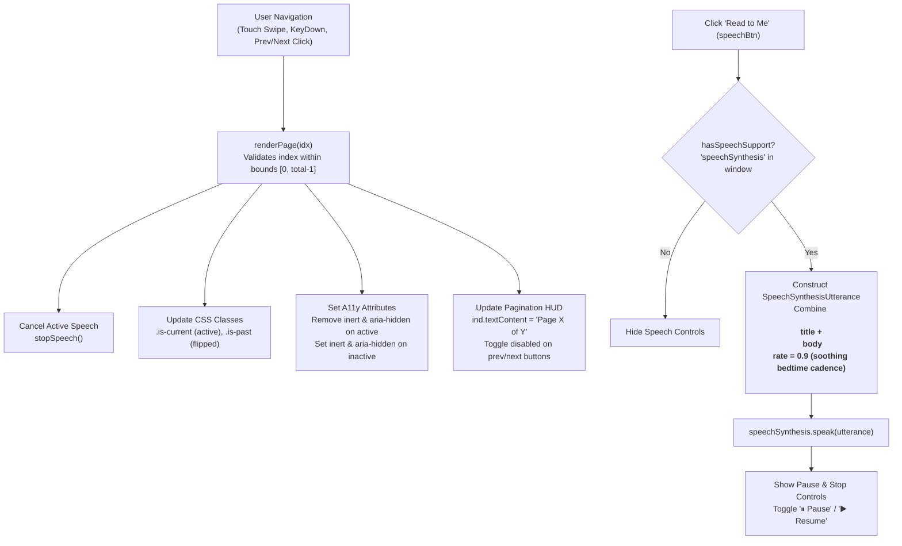

# 📖 Bedtime Storybook & Web Speech Narration Engine

The Bedtime Storybook toy (`storybook.exe` / `pip-book`) is implemented in [`js/toys.js`](file:///c:/Users/Rushabh%20Mahajan/Documents/GitHub/pipOS/js/toys.js) (`initStorybook`). It provides a tactile vector flipbook featuring illustrated micro-stories, multi-modal page navigation (pointer clicks, touch gestures, keyboard arrows), and an integrated Web Speech API narration engine designed with soothing bedtime voice synthesis.

---

## 1. System Architecture & Component Structure

The storybook flipbook comprises an interactive viewport (`#book`) containing progressive `<article class="book-page">` elements, pagination controls, and speech synthesis actions.



---

## 2. Page Navigation Architecture

The flipbook supports three input channels with smooth transitions:

### 1. Touch Gesture & Swipe Calculations
Mobile and touchscreen users can swipe naturally to turn pages. Touch coordinates are captured via passive event listeners to maintain high scroll performance:

- On `touchstart`: Records initial touch origin $(X_{\text{start}}, Y_{\text{start}})$.
- On `touchend`: Computes displacement vectors:
  $$\Delta x = X_{\text{end}} - X_{\text{start}}, \quad \Delta y = Y_{\text{end}} - Y_{\text{start}}$$
- **Swipe Validation Condition**:
  $$\text{Valid Swipe} \iff |\Delta x| > 35\text{ px} \land |\Delta x| > |\Delta y|$$
  - If $\Delta x < -35\text{ px}$ (swipe left): Advances to the next page (`nextBtn.click()`).
  - If $\Delta x > 35\text{ px}$ (swipe right): Returns to the previous page (`prevBtn.click()`).

### 2. Keyboard Navigation
When keyboard focus enters the storybook viewport (`#book[tabindex="0"]`):
- `ArrowRight` or `PageDown`: Flips forward to the next page.
- `ArrowLeft` or `PageUp`: Flips backward to the previous page.

### 3. Pagination Controls & Audio Feedback
- **Previous / Next Buttons**: `#bookPrev` and `#bookNext` trigger page transitions and play a soft pop chime via `PIP.audio.pop()`.
- **Button Invalidation**: `prevBtn.disabled = (current === 0)` and `nextBtn.disabled = (current === total - 1)`.
- **Page Indicator**: `#bookInd` updates text dynamically (`"Page 1 of 4"`).

---

## 3. Micro-Story Data Structure & SVG Scene Graphics

Each bedtime micro-story chapter is encapsulated inside an `<article class="book-page">` container structured as follows:

```text
<article class="book-page [is-current|is-past]" data-page="N" aria-labelledby="bpN">
  ├── <div class="bp-art">
  │     └── <svg viewBox="0 0 280 180" aria-hidden="true">
  │           ├── <rect width="280" height="180" rx="8" fill="var(--sky)"/> (Backdrop)
  │           └── [Inline vector assets: Moon, bedposts, stars, character avatars]
  └── <div class="bp-content">
        ├── <h4 id="bpN">Story Chapter Title</h4>
        └── <p>Narrative prose text...</p>
```

### Existing Story Catalog
1. **Chapter 1: The Midnight Basket**  
   *Illustration*: Wicker basket floating on a white cloud under a crescent moon.  
   *Narrative*: Pip arrives at quarter past midnight with a tiny skull face, sleepy amber eyes, and a crooked starry nightcap.
2. **Chapter 2: The Stolen Star**  
   *Illustration*: Bedpost ladder reaching up to twinkling star clusters.  
   *Narrative*: Pip climbs the tallest bedpost at twilight to tuck fallen stars into the nightcap's woolly brim to protect against bad dreams.
3. **Chapter 3: The Lavender Kettle**  
   *Illustration*: Steaming purple kettle with fragrant herbal steam trails.  
   *Narrative*: Pip brews nocturnal tea from dried lavender buds and honeyed rainwater for restless nursery toys.
4. **Chapter 4: The Sleepy Cloud**  
   *Illustration*: Fluffy pillow-cloud gently carrying Pip into dreamland.  
   *Narrative*: The nursery dims as the great white cloud tucks everyone in with warm starlight blanket folds.

---

## 4. Web Speech API Narration Subsystem

The narration engine leverages the browser's native `window.speechSynthesis` and `SpeechSynthesisUtterance` APIs.

### Feature Detection & Graceful Degradation
Before binding speech events, `initStorybook` verifies browser capability:
```javascript
function hasSpeechSupport() {
  return typeof window !== 'undefined' && 'speechSynthesis' in window && typeof SpeechSynthesisUtterance !== 'undefined';
}
```
If the host platform does not support speech synthesis (or speech synthesis is disabled by user policy), `#storySpeechBtn` is cleanly hidden (`display = 'none'`) without throwing exceptions.

### Bedtime Voice & Utterance Tuning
Story text is extracted dynamically by concatenating the active page title and body paragraph:
$$\text{textToRead} = \text{page.h4.textContent} + \text{". "} + \text{page.p.textContent}$$

The speech utterance is configured for a soothing bedtime cadence:
```javascript
var utterance = new SpeechSynthesisUtterance(textToRead);
utterance.rate = 0.9;  // 10% slower than default for relaxed, calm bedtime listening
utterance.pitch = 1.0; // Natural, warm pitch
utterance.volume = 0.8; // Gentle nursery volume
```

### Playback State Machine
- **Play (`speechBtn` click)**: Cancels any lingering utterances, configures listeners, and calls `window.speechSynthesis.speak(utterance)`. Shows Pause and Stop buttons.
- **Pause / Resume (`pauseBtn` click)**:
  - If `speechSynthesis.paused === true`: Calls `speechSynthesis.resume()` and sets button label to `"⏸ Pause"`.
  - If `speechSynthesis.speaking === true`: Calls `speechSynthesis.pause()` and sets button label to `"▶ Resume"`.
- **Stop (`stopBtn` click or `stopSpeech()`)**: Invokes `speechSynthesis.cancel()`, resets button labels, and restores the primary *"Read to Me"* trigger.
- **Error Handling**: `utterance.onerror = stopSpeech;` ensures the player controls return to idle if the audio device fails, speech synthesis is blocked, or the user navigates away.

### Voice Initialization & Tab Lifecycle
- **Dynamic Voices (`onvoiceschanged`)**: Browsers load system voices asynchronously. When present, the reader can inspect `window.speechSynthesis.getVoices()` for local preferred locales.
- **Cleanup on Page Turn**: Turning the page (`renderPage()`) immediately invokes `stopSpeech()` so that narration from the previous page does not bleed into the next chapter.
- **Cleanup on Window Close/Minimize**: Minimizing or closing the storybook window cancels all queued speech synthesis immediately.

---

## 5. Accessibility & Screen Reader Considerations

The storybook is engineered to comply with WCAG 2.1 AA accessibility standards:

1. **Focus Management & `inert` Polyfill**:
   - Only the active page (`.book-page.is-current`) is perceivable by screen readers or accessible via Tab key navigation.
   - Non-active pages receive `aria-hidden="true"` and the HTML5 `inert` attribute:
     ```javascript
     if (isCur) {
       page.removeAttribute('aria-hidden');
       page.removeAttribute('inert');
     } else {
       page.setAttribute('aria-hidden', 'true');
       page.setAttribute('inert', '');
     }
     ```
2. **Accessible Region & Semantics**:
   - `#book` is tagged with `role="region"` and `aria-label="Bedtime storybook flipbook. Use Left and Right arrow keys to flip pages."`.
   - Each page heading uses `<h4 id="bpN">` referenced by the parent `<article aria-labelledby="bpN">`.
   - Navigation buttons use `aria-disabled="true"` when at boundary limits.
3. **Contrast & Color Tokens**:
   - Background fills use high-contrast theme variables (`var(--paper)`, `var(--sky)`, `var(--mint)`).
   - Text utilizes dark chocolate ink (`var(--line)`, `#5c4033`) ensuring a contrast ratio exceeding $7:1$.

---

## 6. How to Add a New Story Chapter (Code Sample)

To add a new chapter to the flipbook, append an `<article>` element inside `#book .book-viewport` in `index.html`:

```html
<!-- Example: Chapter 5 - The Starlight Bakery -->
<article class="book-page" data-page="5" aria-labelledby="bp5" aria-hidden="true" inert>
  <div class="bp-art">
    <svg viewBox="0 0 280 180" aria-hidden="true">
      <!-- Sky Backdrop -->
      <rect width="280" height="180" rx="8" fill="var(--peach)" />
      
      <!-- Night Nursery Window -->
      <rect x="70" y="25" width="140" height="130" rx="6" fill="#fffdfa" stroke="var(--line)" stroke-width="2.5" />
      <line x1="140" y1="25" x2="140" y2="155" stroke="var(--line)" stroke-width="2" />
      <line x1="70" y1="90" x2="210" y2="90" stroke="var(--line)" stroke-width="2" />
      
      <!-- Steaming Cinnamon Star Bun -->
      <circle cx="140" cy="120" r="18" fill="#e2a16d" stroke="var(--line)" stroke-width="2" />
      <use href="#star" x="133" y="113" width="14" height="14" fill="#ffd98a" />
    </svg>
  </div>
  
  <div class="bp-content">
    <h4 id="bp5">The Starlight Bakery</h4>
    <p>Before dawn breaks, Pip rolls dough made from cloud mist and cinnamon spice, baking warm star buns that fill the nursery with dreams of sunrise.</p>
  </div>
</article>
```
*Note: `initStorybook` calculates total pages automatically via `$$('.book-page', book).length`, so no JavaScript changes are required when adding new chapters.*
