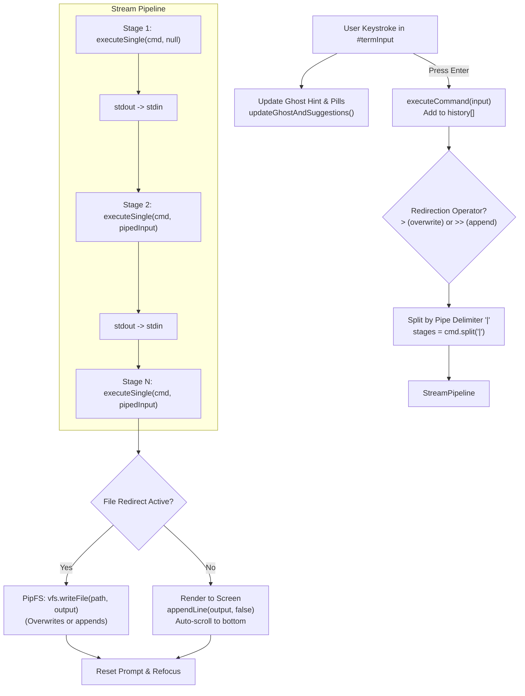

# 💻 PipOS Terminal CLI, Piping & Redirection Manual

The PipOS Midnight Interactive Terminal (`pip-term.exe`) is implemented in [`js/terminal.js`](file:///c:/Users/Rushabh%20Mahajan/Documents/GitHub/pipOS/js/terminal.js). It provides a vintage CRT command-line shell featuring command history navigation, ghost autocomplete hints, POSIX-style multi-stage stream pipelines (`|`), file redirection (`>` and `>>`), and deep integration with PipFS virtual filesystem, the Web Audio synthesizer, and OS desktop controls.

---

## 1. System Architecture & Terminal Lifecycle

The terminal emulator coordinates between a virtual scrollback screen, an interactive prompt, an autocomplete engine, and virtual I/O streams.



### Virtual I/O Streams
1. **`stdin` (Standard Input)**:
   Passed as `pipedInput` parameter to `executeSingle(rawInput, pipedInput)`. If a command appears downstream of a pipe (`|`), its input is fed from the previous stage's standard output.
2. **`stdout` (Standard Output)**:
   Returned as the string property `{ ok: true, output: string }`. If uninterrupted, it is appended to the terminal viewport as `.term-line-out`.
3. **`stderr` (Standard Error)**:
   Returned as `{ ok: false, output: string }` or prefixed with the command name (e.g. `cat: no such file or directory`).

### DOM Architecture & Scrollback Management
- **Screen Viewport (`#termScreen`)**: Displays the interactive transcript.
- **Line Rendering (`appendLine`)**:
  - Command invocations are rendered as `<div class="term-line-cmd">` prefixed with `pip@midnight:~$ `.
  - Outputs are rendered as `<div class="term-line-out">`.
- **Auto-Scroll**: Every output triggers `screen.scrollTop = screen.scrollHeight` to anchor visibility to the latest prompt.
- **Screen Clearing (`clear`)**: Wipes `screen.innerHTML = ''`, giving the user a fresh CRT viewport.
- **Persistent Focus**: Clicking anywhere in the terminal window automatically refocuses `#termInput`.

---

## 2. Tokenizer, Pipeline & Redirection Engine

### 1. File Redirection (`>` and `>>`)
Before executing pipeline stages, `executeCommand` scans for output redirection:
- **Overwrite (`> <filename>`)**: Extracts the destination target and writes raw output via `vfs.writeFile(resolvedPath, currentOutput)`.
- **Append (`>> <filename>`)**: Reads existing file content (if present), appends a newline and the current output, and writes the combined result.

```bash
# Export blocks stats to a text file
blocks stats > /home/pip/stats.txt

# Append a midnight note
echo "Remember to water the lavender" >> /home/pip/notes.txt
```

### 2. POSIX Stream Pipeline Execution (`|`)
Commands separated by the vertical pipe operator `|` run sequentially:
```javascript
var stages = cmdToRun.split('|');
var currentOutput = '';

for (var i = 0; i < stages.length; i++) {
  var stageCmd = stages[i].trim();
  if (!stageCmd) continue;

  var res = executeSingle(stageCmd, i > 0 ? currentOutput : null);
  if (res.clear) return res;
  currentOutput = res.output;
}
```

---

## 3. Command Reference Guide

### Navigation & Shell Utilities
| Command | Arguments | Description | Example |
| :--- | :--- | :--- | :--- |
| `help` | None | Displays the terminal manual and command directory | `help` |
| `whoami` | None | Displays Pip's nursery role, UID, and mission statement | `whoami` |
| `time` / `date` | None | Prints nursery clock and current lunar cycle phase | `time` |
| `pwd` | None | Prints current working directory (defaults to `/home/pip`) | `pwd` |
| `cd` | `[dir]` | Changes active directory in PipFS | `cd /home/pip/documents` |
| `ls` | `[dir]` | Lists entries with icons (`📁`, `📄`) and byte sizes | `ls` or `ls /etc` |
| `cat` | `<file>` | Prints file contents or echoes piped standard input | `cat readme.txt` |
| `touch` | `<file>` | Creates an empty virtual file in PipFS | `touch dream.log` |
| `mkdir` | `<dir>` | Creates a virtual directory in PipFS | `mkdir lullabies` |
| `rm` | `<file>` | Deletes a virtual file from PipFS | `rm temp.txt` |
| `history` | None | Lists numbered execution history of commands | `history` |
| `clear` | None | Resets and clears the terminal viewport | `clear` |

### Text Processing & Pipeline Tools
| Command | Arguments | Description | Example |
| :--- | :--- | :--- | :--- |
| `echo` | `[text]` | Prints text (supports quotes, `\n`, `\t`) or passes through input | `echo "Moonlit sky"` |
| `grep` | `[-i] [-v] <pattern> [file]` | Filters lines matching regex. `-i` ignore case, `-v` invert | `cat log.txt \| grep -i error` |
| `wc` | `[-l] [-w] [-c] [file]` | Counts lines (`-l`), words (`-w`), or characters (`-c`) | `cat file.txt \| wc -l` |
| `sort` | `[-r] [file]` | Sorts lines alphabetically; `-r` sorts in reverse order | `cat names.txt \| sort -r` |
| `uniq` | `[file]` | Filters consecutive duplicate lines from stream | `cat list.txt \| sort \| uniq` |
| `head` | `[-n count] [file]` | Outputs first $N$ lines of text (default: 10) | `cat dream.txt \| head -n 3` |
| `tail` | `[-n count] [file]` | Outputs last $N$ lines of text (default: 10) | `history \| tail -n 5` |

### System & Customization Controls
| Command | Arguments | Description | Example |
| :--- | :--- | :--- | :--- |
| `theme` | `[day\|night\|contrast]` | Displays or toggles desktop color themes | `theme night` |
| `sound` | `[on\|off\|toggle]` | Checks or switches master Web Audio synthesizer | `sound toggle` |
| `quiet` | `[on\|off]` | Toggles quiet nursery notification mode | `quiet on` |
| `sleep` | `[minutes\|cancel]` | Arms bedtime sleep timer with gradual audio fade-out | `sleep 15` |
| `play` | `[chime\|lullaby]` | Synthesizes C-pentatonic chime or gentle nursery melody | `play lullaby` |
| `fortune` / `dream` | None | Dispenses a random midnight philosophical prophecy | `fortune` |

### Game & Toy Launchers
| Command | Arguments | Description | Example |
| :--- | :--- | :--- | :--- |
| `calc` | `<expr>` | Safe binary calculator supporting `+`, `-`, `*`, `/`, `%`, `^` | `calc 24 * 7` |
| `wish` | `<text>` | Submits a dream wish directly to the Midnight Wish Wall | `wish Sleep tight Pip` |
| `blocks` | `[stats\|export\|import]` | Displays high scores or exports/imports stacker records | `blocks stats` |

---

## 4. Keyboard Shortcuts & Autocomplete Engine

### Autocomplete & Ghosting
- **Ghost Text (`#termGhost`)**: Suggests inline autocompletions in faint typography ahead of the cursor.
- **Pill Chips (`#termSuggestions`)**: Renders one-click clickable button suggestions underneath the input bar.
- **Tab Key (`Tab` / `Shift+Tab`)**: Cycles forward and backward through command completions and parameter hints.
- **History Navigation (`ArrowUp` / `ArrowDown`)**: Recalls earlier entered commands from the execution history buffer.

---

## 5. Developer Guide: Registering Custom Commands

To register a new command in `js/terminal.js`:

### 1. Add to Command Catalog
Add the command name string to `COMMANDS`:
```javascript
var COMMANDS = [
  // ... existing commands
  'stars'
];
```

### 2. Configure Parameter Hints (Optional)
If the command takes parameters or subcommands, define them in `PARAM_HINTS` for autocomplete pills:
```javascript
PARAM_HINTS.stars = {
  params: ['stats', 'play'],
  hint: ' [stats|play]',
  pills: ['stars stats', 'stars play']
};
```

### 3. Implement Command Handler in `executeSingle`
Add a `case` block inside the `switch (cmd)` router:
```javascript
case 'stars':
  var action = (args[0] || 'stats').toLowerCase();
  if (action === 'stats') {
    var best = store.get('pip_stars_best', '0');
    out = "⭐ Catch the Falling Stars Records:\n  High Score: " + best + " pts";
  } else if (action === 'play') {
    var win = $('#stars');
    if (win) {
      win.classList.remove('is-minimized');
      win.style.display = 'block';
      out = "Launched Catch the Falling Stars!";
    } else {
      out = "stars: window not found";
    }
  } else {
    out = "Usage: stars [stats|play]";
  }
  break;
```

---

## 6. Example Interactive Session

Below is an authentic CLI session demonstrating pipelines, text filtering, and file redirection:

```text
pip@midnight:~$ whoami
User: Pip the Skull Baby (UID: 001)
Role: Chief Dream Engineer & Midnight Nursery Caretaker
Canon: haX.baby / October 2026
Mission: Putting the neighborhood to sleep one lullaby at a time.

pip@midnight:~$ theme night
Theme switched to night mode 🌙

pip@midnight:~$ echo -e "apple\nbanana\napple\ncherry\nbanana" | sort | uniq
apple
banana
cherry

pip@midnight:~$ calc 2 ^ 8
2 ^ 8 = 256

pip@midnight:~$ blocks stats > /home/pip/records.txt

pip@midnight:~$ cat /home/pip/records.txt | grep -i "best"
  Personal Best: 24 blocks

pip@midnight:~$ wish Stars are shining bright over the nursery
✨ Wish pinned to Midnight Wish Wall: "Stars are shining bright over the nursery"

pip@midnight:~$ sleep 15
🌙 Bedtime sleep timer set for 15 minutes. Audio will fade out gently before bedtime.
```
