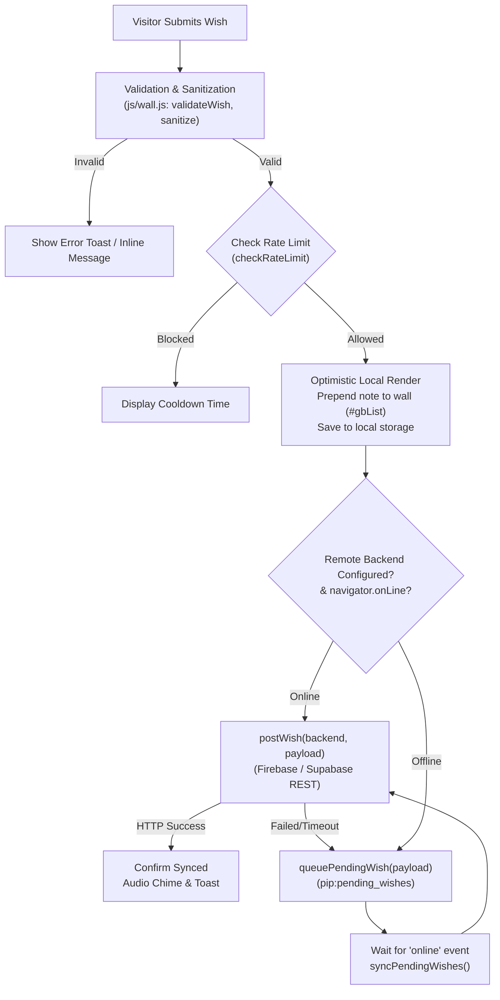
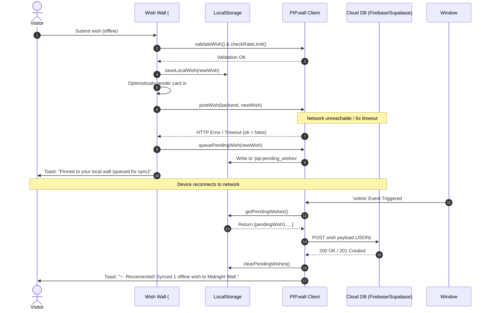

# 🌌 Midnight Wish Wall — Architecture & Offline Sync Protocol

The Midnight Wish Wall (`wish-wall.gb`) is implemented across [`js/wall.js`](file:///c:/Users/Rushabh%20Mahajan/Documents/GitHub/pipOS/js/wall.js) (backend client, sanitization, rate limiting, and sync queue) and [`js/fx.js`](file:///c:/Users/Rushabh%20Mahajan/Documents/GitHub/pipOS/js/fx.js) (DOM card generation, optimistic UI updates, and local storage). It allows visitors to leave bedtime wishes, pin them to a persistent board, and synchronize them live across dreamers or queue them safely when offline.

---

## 1. System Architecture & Component Interaction

The wish wall follows an offline-first architecture with optimistic UI updates and pluggable cloud database synchronization.



---

## 2. Security & Sanitization Specification

Because user-submitted text from unknown visitors is displayed on the wall, strict multi-layer defense-in-depth sanitization prevents Stored Cross-Site Scripting (XSS), prototype pollution, and DOM injection.

### 1. Control Character & Unicode Stripping (`sanitize(str)`)
Input strings are stripped of non-printable ASCII control characters, null bytes, bidirectional overrides, and zero-width invisible joiners:
```javascript
function sanitize(str) {
  if (typeof str !== 'string') return '';
  return str.replace(/[\u0000-\u001F\u007F-\u009F\u200B-\u200D\uFEFF]/g, '').trim();
}
```

### 2. Length Capping & Boundary Validation (`validateWish(wish, name)`)
- **Wish Content (`w`)**: Required, minimum 1 character, maximum **120 characters**.
- **Author Name (`n`)**: Optional, sanitized, truncated to maximum **20 characters** (defaults to `"A sleepy visitor"` if omitted).
- Payload schema: `{ n: string, w: string, t: number }`.

### 3. DOM Injection Defense (`createNoteElement`)
- The UI layer in `js/fx.js` **never** utilizes `innerHTML` or `outerHTML` for user-supplied data.
- Text nodes are assigned strictly via `node.textContent`, guaranteeing that HTML entities, script tags (`<script>`), SVG payloads, or event handlers (`onload=`, `onerror=`) are treated purely as inert text:
```javascript
var bodyEl = document.createElement('p');
bodyEl.className = 'gb-body';
bodyEl.textContent = wishItem.w; // Safe assignment
```

---

## 3. Rate Limiting & Anti-Spam

To prevent flooding, spam bots, and resource exhaustion, `checkRateLimit(history, now)` implements a client-enforced dual-interval rate limiter:

| Parameter | Value | Description |
| :--- | :---: | :--- |
| **`COOLDOWN_MS`** | $15,000\text{ ms}$ ($15\text{s}$) | Minimum cooldown duration between consecutive wishes from the same client. |
| **`WINDOW_MS`** | $600,000\text{ ms}$ ($10\text{ min}$) | Sliding time window for frequency quota tracking. |
| **`MAX_PER_WINDOW`** | $5\text{ wishes}$ | Maximum number of wishes permissible within any 10-minute sliding window. |

### Error Messaging & Wait Times
- **Consecutive Cooldown Triggered**:
  > *"Pip is still reading your last wish! Please wait {waitSec}s."*
- **Window Quota Exceeded**:
  > *"Pip needs a nap! Too many wishes pinned recently. Try again soon."*

---

## 4. Optimistic UI & Local Persistence

1. **Immediate Rendering (LIFO Order)**:
   - When a wish is submitted, the UI creates a local card immediately without blocking on network latency.
   - Pinned cards are inserted in Last-In-First-Out (LIFO) order, appearing at the top of the `#gbList` grid.
2. **Audio & Haptic Feedback**:
   - Submitting a valid wish triggers Pip's ascending lullaby confirmation chime (`audio.SCALE[4]` and `audio.SCALE[6]`) and unlocks the `'wish'` sticker in `js/stickers.js`.
3. **Storage Keys in LocalStorage**:
   - `'wishes'`: Array of local personal wishes.
   - `'visitor'`: Last entered nickname auto-populated for future wishes.
   - `'wall_remote_cache'`: Cached snapshot of remote community wishes for instant offline loading.
   - `'pip:pending_wishes'`: Queue of offline wishes awaiting remote synchronization.

---

## 5. Offline Sync Queue Protocol (`pip:pending_wishes`)

When a user posts while offline, or if the cloud backend fails to respond within the 6-second timeout window, the wish is queued for asynchronous synchronization.

### Queue Schema
Stored under `pip:pending_wishes` (and mirrored to `pending_wishes` for backward compatibility):
```json
[
  {
    "n": "Star Gazer",
    "w": "May tomorrow bring quiet rain and good dreams.",
    "t": 1731998400000
  }
]
```

### Sequential Synchronization Pipeline (`syncPendingWishes`)
When synchronization runs:
1. Validates that another sync operation is not already active (`isSyncing = false`).
2. Iterates sequentially through remaining queued wishes.
3. For each wish, performs a remote `POST` request.
4. **On Success**: Shifts the wish out of the queue, updates LocalStorage, and proceeds to the next pending item.
5. **On Failure**: Aborts further attempts, preserves remaining items in LocalStorage, and yields control until the next connectivity trigger.

### Automated Online Event Listener
Pip OS listens for browser connectivity events:
```javascript
window.addEventListener('online', function () {
  var backend = getBackendConfig();
  if (backend) {
    PIP.wall.syncPendingWishes(backend, function (count) {
      if (count > 0) {
        PIP.toast('✨ Reconnected! Synced ' + count + ' offline wish' + (count > 1 ? 'es' : '') + ' to Midnight Wall.');
      }
    });
  }
});
```

---

## 6. Offline-to-Online Synchronization Sequence



---

## 7. Backend Adapter Specification

The sync engine interfaces with multiple backend providers through standard REST interfaces:

### 1. Firebase Realtime Database
- **Fetch Endpoint**: `GET <url>.json?orderBy="$key"&limitToLast=30`
- **Post Endpoint**: `POST <url>.json`
- **Response Format**: Object of dynamic push IDs `"-Nabc123": { n, w, t }`.
- **Normalization**: `parseRemotePayload` converts the push-ID map into an array sorted descending by timestamp $t$.

### 2. Supabase PostgREST
- **Fetch Endpoint**: `GET <url>?select=n,w,t&order=t.desc&limit=30`
  - Headers: `apikey: <key>`, `Authorization: Bearer <key>`
- **Post Endpoint**: `POST <url>`
  - Headers: `apikey: <key>`, `Authorization: Bearer <key>`, `Prefer: return=minimal`
- **Response Format**: Array of JSON row objects `[ { n, w, t }, ... ]`.

### 3. Timeout & Abort Controller
All remote requests initialize a 6-second watchdog timer:
```javascript
var controller = typeof AbortController !== 'undefined' ? new AbortController() : null;
var timer = controller ? setTimeout(function () { controller.abort(); }, 6000) : 0;
```
If the network stalls, the request aborts gracefully, returning `null` or `false` to invoke the local fallback without blocking the browser.

---

## 8. Public JavaScript API Reference

Exposed under `window.PIP.wall` and `module.exports`:

```javascript
PIP.wall = {
  sanitize: Function,             // (str: string) -> string
  validateWish: Function,         // (wish: string, name: string) -> { ok, wish, name, error }
  checkRateLimit: Function,       // (history: number[], now?: number) -> { allowed, wait, error, history }
  parseRemotePayload: Function,   // (data: any, type: 'firebase'|'supabase') -> wishItem[]
  fetchWishes: Function,          // (backend, cb: (items: wishItem[]|null) => void) -> void
  postWish: Function,             // (backend, wishData, cb: (success: boolean) => void) -> void
  PENDING_KEY: 'pip:pending_wishes',
  getPendingWishes: Function,     // (customStore?) -> wishItem[]
  queuePendingWish: Function,     // (wishItem, customStore?) -> boolean
  clearPendingWishes: Function,   // (customStore?) -> void
  syncPendingWishes: Function,    // (backend, cb?: (syncedCount: number) => void, customStore?) -> void
  COOLDOWN_MS: 15000,
  WINDOW_MS: 600000,
  MAX_PER_WINDOW: 5
};
```
